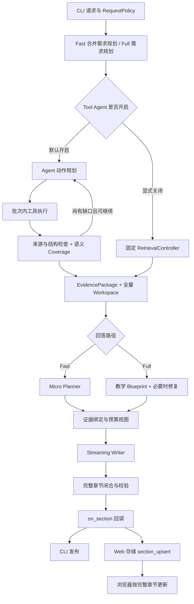

# 第 1 阶段：问题诊断与可复现基线

日期：2026-10-14（Asia/Shanghai）。本阶段建立观察、取证快照和回答重放边界，不重构生产检索策略、教学规划或流式发布协议。

## 1. 执行前保存现有工作

| 工作树 | 分支 | 提交 | 内容 | 本次验证 |
|---|---|---|---|---|
| DevContext | codex/v5-evidence-loop | `47c6db387742f1e5f76e657163d3e81a02a58e4f` | README 与 33 份非空项目/历史文档 | 内容范围核对；没有业务源码变更 |
| DevContext-web-ui-v1 | codex/web-ui-v1 | `2276c3e5016bbf552989831722569039e295424f` | 原有 Web V1、应用服务、取消和证据发布接入、前端及说明 | Python 776 passed / 11 skipped；前端 7 passed；类型检查和生产构建通过 |

两份提交分别保留在原分支，没有合并。主工作树测试文件有换行状态差异但内容 diff 为空，未作为测试修改提交。空文档、不能识别为有效 Visio ZIP 的图示、`trace.json` 留在本地。四份历史 `.txt` 包含原终端回答、外部回答对比和已有 Markdown 的重复说明，已检查并保留在本地，不混入本次功能提交。Web 提交保存已有内容，原有两个 EOF 空行告警未扩大为格式清理任务。11 项数据库集成测试没有在该次运行启用，历史 Web 验收报告不能替代本次验证。

## 2. 当前执行链路与诊断缺口



确认的问题：

1. 默认 Agent 路径在需求规划之后仍有 Agent 规划和 Coverage 模型调用。Fast 首轮动作对象不会直接作为 Agent 批次执行；是否合并这些决策仍需后续实验。
2. 证据充分后还要生成独立回答计划。Fast 计划再绑定写作证据，存在检索所得与 Writer 所见不一致的可能。
3. Micro Planner 按顺序截取证据，累计 16000 字符、每条最多 3500 字符。不能凭 Workspace 有材料就认为回答模型看到了完整材料。
4. Streaming Writer 只在整节闭合和校验后调用输出回调。模型开始输出和用户获得一节内容是不同时间点。
5. 原用量汇总把未知用量按零相加，会将部分已知用量误当完整总量。

待验证的假设：较少独立规划、直接连贯写作、更合适的证据包可能改善速度和质量；当前阶段没有实现这些候选方案，也不宣称提升已成立。模型与服务负载对等待的影响还需要重复对照。

Web 仅做只读核对：`RunManager` 从完整章节回调存储事件，前端 `applyEvent` 将章节拼接为答案。没有测量浏览器绘制时间，`browser_first_visible` 为 null；后端回调不能替代它。

## 3. 固定开源参考与适配

固定参考文件、SHA256 和下载记录在 `artifacts/refactor-stage1/references/manifest.json`。本阶段未增加 LlamaIndex 或 LangGraph 依赖。

| 问题 | 固定版本与读取内容 | 采用的机制 | 适配与验证 |
|---|---|---|---|
| 取证与实际写作输入混在结果里 | LlamaIndex `5b7b6e323e1da3edd787a2104a89257c14f026d0` 的 BaseSynthesizer、RetrieverQueryEngine、SimpleSummarize 测试 | retrieve 与 synthesize 可分开调用，响应保留 source_nodes，测试检查实际模型消息及流式返回 | 快照区分 Workspace、ContextBundle 和各次模型消息；注入回答工作流进行离线重放 |
| 首 Token、阶段完成、发布不能混用 | LangGraph `ccb851effb7b4c6255add86dbeed577061475aff` 的 types、Pregel main、test_pregel | messages/custom/updates/tasks 分流；执行状态带步骤上下文；测试验证节点尚未结束时自定义消息已交付 | 独立记录 content、正文、有效章节及回调发布；事件不参与父子耗时加总 |

源码链接：[LlamaIndex BaseSynthesizer](https://github.com/run-llama/llama_index/blob/5b7b6e323e1da3edd787a2104a89257c14f026d0/llama-index-core/llama_index/core/response_synthesizers/base.py)、[RetrieverQueryEngine](https://github.com/run-llama/llama_index/blob/5b7b6e323e1da3edd787a2104a89257c14f026d0/llama-index-core/llama_index/core/query_engine/retriever_query_engine.py)、[SimpleSummarize 测试](https://github.com/run-llama/llama_index/blob/5b7b6e323e1da3edd787a2104a89257c14f026d0/llama-index-core/tests/response_synthesizers/test_simple_summarize.py)、[LangGraph types](https://github.com/langchain-ai/langgraph/blob/ccb851effb7b4c6255add86dbeed577061475aff/libs/langgraph/langgraph/types.py)、[Pregel 执行](https://github.com/langchain-ai/langgraph/blob/ccb851effb7b4c6255add86dbeed577061475aff/libs/langgraph/langgraph/pregel/main.py)、[流式测试](https://github.com/langchain-ai/langgraph/blob/ccb851effb7b4c6255add86dbeed577061475aff/libs/langgraph/tests/test_pregel.py)。

实际阅读了 `test_synthesize__streaming`、`test_stream_buffering_single_node`、`test_tags_stream_mode_messages`。这里借鉴观察和生成边界，不照搬通用节点作为 Java Graph 证明。

## 4. 本次接口和行为

- `capture_diagnostics(secrets=...)`：独立的请求局部可选捕获。未开启时不序列化证据或模型消息；不会改变生成请求、重试和章节发布策略。
- `record_package`：在回答前保存 EvidencePlan、完整 Workspace 原文、检索 Bundle、覆盖、未解决需求、关系/探测/路径和发现轮次。
- `record_progress`：工具取得材料后保留最新进度，控制器构包前异常时仍可检查已有材料；它不等于一个已完成、可重放的 EvidencePackage。
- 客户端记录每次实际调用的消息、模型/预算参数和完成状态，不保存密钥和认证配置。模型重试有独立 attempt。
- `restore_package` / `replay_answer`：恢复 v1 JSON 快照，保留原标签和归属轮次，通过已有结构校验恢复关系，调用外部注入的回答工作流。没有数据库检索或自动模型选择。
- 用量汇总完整时返回 total；缺少上报时 total 为 null，known_total、reported_count、missing_count 显示已知部分。无调用时总量为 0。

时间指标使用同一 capture 起点的相对毫秒：

| 字段 | 定义 |
|---|---|
| retrieval_started / retrieval_finished | 取证开始 / EvidencePackage 取得且快照保存 |
| writer_started | 首次正文生成调用开始 |
| provider_first_content | Writer 收到第一段非空可见 content，包括协议标记 |
| provider_first_body | 去除章节标记和 Markdown 标题后首次出现正文；用于协议内正文观察，不等于事实已核查 |
| first_section_ready | 第一个通过既有校验的完整章节 |
| first_published | 第一次输出回调完成 |
| browser_first_visible | 本阶段不测量，保留 null |
| request_finished | 结果或异常被记录 |

## 5. 复现与原始产物

```powershell
.venv/Scripts/python.exe -m pytest tests/test_diagnostics.py tests/test_perf_trace.py tests/test_answer_quality_runner.py tests/test_single_stream.py tests/test_answer_engine.py
.venv/Scripts/python.exe -m pytest
.venv/Scripts/python.exe scripts/run_refactor_stage1.py --output artifacts/refactor-stage1/live-新的唯一目录
```

实验只接收 ignored `artifacts/` 内目录，拒绝覆盖已有样本。每题一次 Fast、显式 120 秒总预算，不预热，不追加 Full 或裁判。连续外部服务不可用或认证/余额失败时停止并标注剩余题未执行。该预算只属于实验。

`manifest.json` 记录代码基点、工作区差异哈希、新增诊断/脚本哈希、固定题集哈希、配置白名单、参考版本与索引指纹。采样在诊断代码未提交时进行，不能将基点提交单独当作采样完整版本。

本次原始结果目录为 `artifacts/refactor-stage1/live-20261014/`。离线重放用法：

```python
from devcontext.observability.diagnostics import replay_answer

# answer_workflow 是注入了本地模型替身的 TeachingExplanationWorkflow，
# 或任何实现 run(request, evidence_package, on_section=...) 的回答对象。
result = replay_answer(
    "artifacts/refactor-stage1/live-20261014/S1-05.snapshot.json",
    answer_workflow,
)
```

`replay_answer` 本身不检索，也不替调用方配置模型。如果调用方注入真实模型，产生的新生成请求属于另一次实验，不属于本次离线验收。

每题保存 snapshot、perf、answer 和 manual review。真实原文与完整请求保持在忽略目录，不进入 Git。快照若发生脱敏替换，重放使用的是脱敏内容；不要据此声称与服务请求逐字相同。

## 6. 验证和真实采样结果

六题均已执行，各题只有一次观察。模型为当前 `deepseek-flash`，默认 Tool Agent 开启，实际请求 Fast/low。索引包含 CODE 601 条、DOCUMENT 3848 条，前后知识片段指纹一致。没有预热、Full 对照、新候选答案或裁判调用。

| 问题 | 取证结束秒 | Writer 开始秒 | 首正文秒 | 首发布秒 | 请求结束秒 | 模型调用 | 检索/Writer证据 | 生成/证据状态 |
|---|---:|---:|---:|---:|---:|---:|---|---|
| S1-01 责任链定义与使用 | 57.54 | 69.09 | 87.88 | 89.92 | 98.84 | 7 | 20 / 20 | complete / READY |
| S1-02 责任链设计动机 | 20.32 | 38.64 | 57.31 | 58.64 | 65.70 | 5 | 11 / 9 | complete / READY |
| S1-03 购票占座一致性 | 28.87 | 53.55 | 80.42 | 83.48 | 92.59 | 5 | 10 / 9 | complete / READY |
| S1-04 并发防重复售卖 | 24.69 | 42.23 | 57.45 | 59.60 | 68.30 | 6 | 8 / 8 | complete / READY |
| S1-05 订单与车票事务 | 103.06 | 116.80 | 未到达 | 未发布 | 120.03 | 9 | 23 / 9 | failed / PARTIAL |
| S1-06 注册入口定位 | 9.86 | 16.00 | 21.26 | 22.90 | 22.91 | 5 | 5 / 3 | complete / READY |

时间来自统一 capture 起点，脚本外围总耗时还包含保存等少量开销。S1-05 的 17 字失败提示不是技术回答；没有首正文，不将该值记作 0。S1-04 包含一次 Writer 重试；第 3 阶段复核原始记录后更正：首次 Writer 尝试约 13.6 秒，没有正文，错误为 missing or unclosed section（此前误记为 Planner 格式恢复），模型调用数按实际 attempt 计数。

### 人工核查结论

| 样本 | 核查材料与判断 |
|---|---|
| S1-01 | 核对容器摘要 E8、执行正文 E10、装配正文 E14、用户名处理器 E20。骨架和异常中断可理解，S1/S2/S4职责重复，没有实际注册入口贯穿请求。20条材料都进入Writer，却有28次章节白名单引用清理，其中包含已输入的E14/E15/E10等证据。 |
| S1-02 | 原方案、变化压力与扩展代价有解释，顺序和跳转代价重复。容器装配和Service启动校验链的正文未取得；已取得的Controller.register E9被Writer选材省略。后文承认缺口，前文仍较多依据历史设计描述项目机制。 |
| S1-03 | 核对reserveLocally、purchaseTickets、缓存删除和事务类型摘要。没有取得doPurchaseInTransaction正文，未解释条件更新底线；正文把令牌称为进入锁内后的闸门，实际takeToken先于加锁。补偿调用/异常文案被升级为座位已释放，非成功响应被升级为订单未创建，恢复最终只留一笔订单和缓存最坏影响必为少卖均缺完整证明。无非法引用警告仍存在这些问题。 |
| S1-04 | 解释两级锁和提交后返还令牌，但缺事务方法与实际座位更新。出现“锁能保证不重复卖”“防超卖正确性路径已经成立”等过强结论；历史回归样本不能认证当前所有并发场景。核心检索criteria仅要求锁/事务/原子操作至少一种，容易把相关机制存在当成完整保证。 |
| S1-05 | 取证耗时103秒，所得23条中存在排序order()、DTO、接口等偏题材料；覆盖仍PARTIAL。回答计划继续耗时约13.7秒，Writer只剩约3.2秒而未产出正文。失败保存了全部原文、阶段、实际输入及状态，不能用失败提示判断回答质量。 |
| S1-06 | 核对UserInfoController摘要、register正文和UserLoginService接口，入口、HTTP映射和直接委托符合证据。首尾重复入口结论；唯一章节几乎等同最终完成时发布。 |

人工核查结合实际 Writer 输入与原文，不仅检查标签；完整逐题记录在各题 `.review.json`。这是关键断言抽查，未认证整篇所有事实。没有执行模型裁判。

确认的下一阶段证据：

1. 取证后独立回答计划继续阻塞6～25秒，本次四个复杂完成样本的首发布均只比请求结束提前约7～9秒。
2. 证据全量进入Writer也可能因章节归属白名单被删引用，应该将“未检索到”“未进入输入”“已输入但不允许引用”分开。
3. 几个复杂问题缺失的是关键被调方法正文，不能仅靠改输出风格修复。Coverage的需求粒度和强保证验证值得在取证阶段重构时处理。
4. 完成状态和合法引用不保证教学准确性；需保留事实支持核查，禁止以篇幅或成功退出代替。

六份实际快照均以本地注入回答替身离线重放，验证了引用标签、原文数量、结构和PARTIAL状态；没有重新检索或发起模型请求，结果记录在 `offline-replay.json`。

采样完成后增加了拆分协议标记、取消状态、独立Catalog恢复的确定性测试和诊断边界修正，以及提交参考清单；没有改变检索、生成或发布算法，也没有重新采样。采样源码的tracked差异和新增源码已保存在 `implementation.patch` / `implementation-new-files/`，不能直接将最终提交版本宣称为六题当时精确源码。

### 验证范围与限制

- 本阶段相关测试：131 passed（包含诊断、性能、质量Runner、Single Stream和Answer Engine）；最终全套 **779 passed / 11 skipped**，11.93秒。
- Web已有工作保存时验证Python776 passed / 11 skipped、前端7 passed及构建；本阶段未修改Web运行代码。
- PostgreSQL现有知识索引用于真实六题，未开启会写数据库的11项集成测试，以保持采样快照。知识片段指纹不等于对所有Graph表或向量列逐字校验。
- 本阶段没有浏览器绘制测量，没有全链路新旧对照，没有重复统计，不能报告稳定P95或架构提升。
- v1快照与当前模型对象字段适配，未来域模型修改需要明确迁移；结构恢复与引用恢复通过校验，但不代表语义事实获认证。
- 未完成EvidencePackage时保留progress；progress只有诊断用途，不伪装为充分或可直接重放的正式包。

## 7. 后续阶段

下一阶段先复核已经保存的 Web 应用服务，制定统一 CLI/Web 应用入口的详细计划；不要重复实现 Web 工作树已经完成的抽取。其后流式传输阶段应优先解决正文到达与整节发布之间的等待，回答阶段使用本次冻结证据对照评估教学规划与连续写作。

本阶段完成后写明验证、限制与提交并停止，不自动实施下一阶段。
