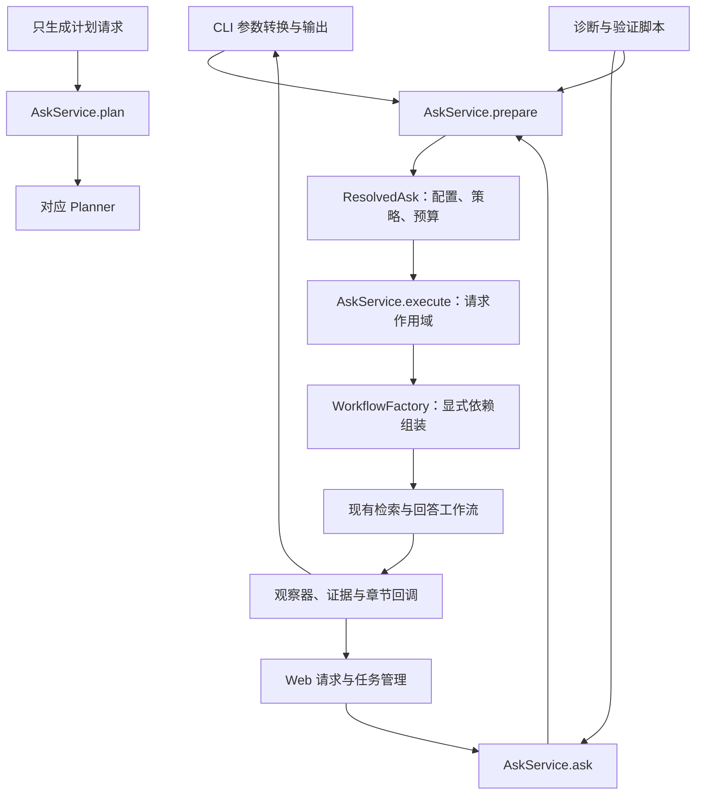

# 第 2 阶段报告：统一问答应用入口

本阶段完成 Web 已有实现与阶段 1 诊断能力的整合，并将 CLI、Web、采样脚本接到共同的应用层。检索与回答算法、提示词、模型预算、引用限制和章节发布协议沿用原实现。

验收日期：2026-10-14。工作分支：`codex/stage2-application-boundary`。

## 1. 原有问题与实际改动

| 已确认的问题 | 代码依据 | 本次处理 |
|---|---|---|
| 主项目 CLI 同时负责输入输出和工作流组装 | 阶段 1 的 CLI 包含模型、Planner、检索、图和 Writer 构建函数 | 整合已有 application 包，CLI 的 Ask 操作只调用应用服务 |
| Web 组装层依赖 CLI 全局变量 | 保存版本存在 `WorkflowFactory(globals())`，内部 `_resolve()` 按字符串解析 | 改为显式构造参数与直接组件调用，删除字典查找和全局回退 |
| 请求解析存在绕过路径 | CLI 先 resolve，再调用 `ask(..., configure=False)` | `prepare → execute`；便捷 `ask` 使用同一路径 |
| 只生成计划可以误执行回答 | `AskRequest.plan_only` 被原 `AskService.ask` 忽略 | 独立 `PlanRequest/plan`；Ask 收到 plan_only 明确拒绝 |
| 生产组装依赖评测专用组件 | 原 assembly 导入 Frozen Planner 与 OracleCoverageChecker | 移到 evaluation 适配模块，通过 RetrievalOverrides 注入 |
| 多个工作树各有完整功能 | 阶段 1 有诊断，Web 有执行范围、取消与证据发布 | 三方合并保留两侧功能，以整合提交建立重构前检查点 |

开始前检查没有发现新增的实质业务源码修改。原测试的 LF/CRLF 状态没有内容差异；历史未跟踪材料与运行记录继续保留，没有制造测试逻辑修改提交。

共同祖先为 `2bcd21f8aed87f8bbebf9d37155497d201b349d7`。以阶段 1 提交 `3d05c22e9086e15940ded2497f0db163965e5db4` 建立工作分支，合并 Web 提交 `2276c3e5016bbf552989831722569039e295424f`。README 出现文本冲突，按当前项目同时支持 CLI/Web 修正；重叠的 Writer 与模型文件自动合并后进行了回归。未采用两个分支最终目录的直接覆盖。

整合检查点：`b4b1a6bbb7962c8266a0c57c5bc872dbca1d21ba`，提交说明为 `merge: integrate saved web application with stage-one diagnostics`。原 Web 分支和工作树保持原提交，未合并回历史分支，也未推送远端。

## 2. 固定开源参考与适配理由

参考清单保存于 [02-reference-sources.json](02-reference-sources.json)，包含固定提交、模块路径、源码链接和文件 SHA-256。本地原文位于忽略目录 `artifacts/refactor-stage2/references/`。

| 项目与固定版本 | 实际阅读内容 | 采用方式与验证 |
|---|---|---|
| LlamaIndex `5b7b6e323e1da3edd787a2104a89257c14f026d0` | `RetrieverQueryEngine` 的构造函数、from_args、retrieve/synthesize；BaseSynthesizer；query_engine 与 SimpleSummarize 的替身测试 | 构建与执行分开，检索与回答组件明确传入；本项目用参数注入和本地模型替身验证组装兼容 |
| Continue `5522c6f44ca0ac3528b37244818fbfa39b5af470` | Core 构造注入、聊天消息处理器、请求取消控制器；llmStreamChat 的执行参数和取消检查；IMessenger 协议 | 外部协议转换留在适配层，单次执行进入公共服务；取消和证据回调绑定请求范围，并验证并发隔离 |

具体源码：[LlamaIndex QueryEngine](https://github.com/run-llama/llama_index/blob/5b7b6e323e1da3edd787a2104a89257c14f026d0/llama-index-core/llama_index/core/query_engine/retriever_query_engine.py)、[QueryEngine 测试](https://github.com/run-llama/llama_index/blob/5b7b6e323e1da3edd787a2104a89257c14f026d0/llama-index-core/tests/query_engine/test_retriever_query_engine.py)、[SimpleSummarize 测试](https://github.com/run-llama/llama_index/blob/5b7b6e323e1da3edd787a2104a89257c14f026d0/llama-index-core/tests/response_synthesizers/test_simple_summarize.py)、[Continue Core](https://github.com/continuedev/continue/blob/5522c6f44ca0ac3528b37244818fbfa39b5af470/core/core.ts)、[聊天执行函数](https://github.com/continuedev/continue/blob/5522c6f44ca0ac3528b37244818fbfa39b5af470/core/llm/streamChat.ts)。

这里借鉴的是职责和依赖边界。LlamaIndex 的部分默认构建依赖全局 Settings，本项目为多个并发请求采用配置副本，没有照搬全局模型状态。Continue 使用异步生成器和 AbortController，本项目本阶段保留同步工作流、线程取消令牌和整节回调；没有宣称具备同样的增量传输或立即中止网络调用能力。

未安装两个框架，也未运行它们的测试套件。已阅读 LlamaIndex 固定版本测试；Continue 的猜测路径 `core/protocol/messenger/index.test.ts` 不存在，未把它列为参考或测试通过项。GitHub 目录 API 遇到限流，固定原文链接仍可读取。

## 3. 最终调用链与接口



| 公共接口 | 行为 |
|---|---|
| AskRequest | 独立于 argparse 和 HTTP 的问答参数 |
| ResolvedAsk | prepare 得到的请求、有效配置、策略、top_k、max_chars 和回答模式 |
| AskService.prepare | 无模型/检索构建；校验并解析一次 |
| AskService.execute | 为每次运行重新创建配置副本和工作流；用于重复性能采样 |
| AskService.ask | prepare 和 execute 的便捷调用，接收 observer/on_section/on_evidence/cancellation |
| PlanRequest / AskService.plan | 使用对应计划格式，不构建检索和回答工作流 |
| WorkflowFactory.build_answer_workflow | 从准备结果组装现有回答链路 |
| WorkflowFactory.build_question_planner / build_evidence_planner | 两类计划构建；production=True 保留 Fast 生产规划器选择 |
| WorkflowFactory.build_retrieval_engine | 构建取证入口，可显式接收 RetrievalOverrides |
| WorkflowFactory.build_teaching_workflow | 独立回答阶段；可以注入本地替身供冻结证据重放 |

有效配置继承原参数规则。Fast/Full 默认、single_stream/v3 别名、Multi-pass、Explain、Legacy、no-plan 及冲突判断保持兼容。新增提前拒绝空问题、非正整数预算、非有限/非正超时和非法枚举。

`ResolvedAsk` 的外层是冻结数据类型；其中 Settings 是执行配置快照，应视为只读。每次 execute 和默认组装都会复制配置，业务工作流修改自己配置时不会修改准备结果或服务基础配置。

WorkflowFactory 可显式接收模型客户端构建函数、兼容客户端类型、检索服务、图存储、取证引擎和教学工作流构建函数。默认依赖集中在组装模块。AskService 同时保留明确的高层 workflow_factory/legacy_factory 替身接口，方便已有嵌入调用和测试迁移；这些接口不查询 CLI 全局变量。

CLI 中的旧私有构建函数仍保留一个兼容周期，全部为应用组装的薄转发。项目内两份采样/验证脚本已迁移到公共接口。评测专用转换在 `evaluation/assembly.py`，原始 frozen_case 不进入生产组装器。

使用示例：

```python
from devcontext.application import AskRequest, AskService, PlanRequest
from devcontext.config import Settings

service = AskService(Settings())
request = AskRequest("项目为何采用责任链校验？", profile="fast")
prepared = service.prepare(request)
result = service.execute(prepared, on_section=publish_section)

# Web 等调用方也可直接使用同一服务。
result = service.ask(request, on_section=publish_section, on_evidence=show_evidence)

# 计划格式为 evidence 或 legacy；不执行检索问答。
plan = service.plan(PlanRequest("用户注册入口在哪里？", format="evidence"))
```

`AskRequest.from_cli` 已移除，CLI 适配函数负责转换。`configure=False` 已移除；旧的 `resolve_request` 现在返回 ResolvedAsk，不再返回二元组。向 ask/prepare 传入 `plan_only=True` 抛出明确错误，调用方需迁移至 plan。

## 4. 保留的诊断、取消与发布行为

- 保留原 PerfRecorder、诊断快照 v1、未知用量、稳定引用映射与离线重放接口。
- 保留观察器、实际 Writer 证据发布和已验证章节回调；Web 路由、存储和 SSE 事件协议保持原行为。
- execution_scope 在构建工作流之前检查取消，结束或异常时恢复上下文。RequestCancelled 仍位于 Exception 之外，不进入普通模型重试或回答降级。
- 同一个 AskService 可以处理并发请求，各次执行独立复制配置、构建工作流和绑定回调；诊断 capture 继续由实验调用方按请求启用。
- 未增加正文 delta，未测量浏览器首次绘制，未把首节回调代替浏览器显示时间。
- Web 仍为可选依赖；普通应用层导入不加载 FastAPI、Uvicorn 或 Web 模块。

## 5. 测试与离线验收

整合后、正式重构前的 Python 回归已通过。最终重构后的结果：

| 验证 | 结果 | 范围 |
|---|---|---|
| 新增应用边界测试 | 34 passed | 参数提前拒绝、入口解析一致性、独立计划、配置副本、并发取消/证据隔离、异常诊断、离线重放、依赖边界、Coverage 单独替换保留 Fast Planner |
| 最终全套 Python | **831 passed / 11 skipped** | 包含应用、CLI、回答、取证、流式、诊断、评测及 Web 回归；17.11 秒 |
| 前端单元测试 | **7 passed** | 已有事件与聊天测试 |
| 前端类型检查及构建 | **通过** | vue-tsc 与 Vite |
| 浏览器端到端 | **3 passed** | Fast/Full 历史和证据；取消/失败/部分结果；断网与移动端布局，使用本地服务替身 |
| 六份实际快照重放 | **6/6 通过** | 标签、原文 Context、结构元数据与 READY/PARTIAL 状态 |
| 新旧组装对照 | **Fast、Full、Legacy 一致** | 相同冻结证据下，模型消息和参数、取证请求、证据交接、章节回调与最终答案逐项比较 |

11 个跳过项需要显式开启 PostgreSQL 集成测试，本阶段未启用，未执行写知识库测试。浏览器测试验证协议与显示行为，没有验证真实模型效果或首次绘制时间。

离线对照基线直接读取整合检查点的原组装和原应用服务源码；新实现通过公共服务执行。所有模型与取证调用均为本地替身，外部调用为 0。Fast/Full 的本地生成状态均 complete，Legacy 保持无教学生成状态。这只证明固定实验条件下的兼容性，不证明所有真实请求完全等价，也不代表回答质量提升。

对照注入的是固定取证结果，因此没有测量真实工具检索链路的性能，也没有拿替身输出当作项目技术答案。实际检索组件的默认选择和替身优先级由组装回归及原有取证测试补充覆盖。

复现：

```powershell
uv sync --locked --extra dev --extra web
uv run --extra dev --extra web pytest -o addopts= -q -ra
uv run --extra dev --extra web python scripts/verify_refactor_stage2.py

cd frontend
npm ci
npm test
npm run build
npm run test:e2e
```

重放命令需要本地六份阶段 1 快照及整合检查点 Git 历史。缺少快照时明确失败，不重新检索或调用模型补齐。浏览器测试使用 8000/5173，需要端口空闲；本次运行没有停止已有用户服务。

## 6. 提交范围与本地保留

整合检查点包含原 Web 功能和 README 冲突修复；阶段成果包含应用层重构、CLI/脚本迁移、评测适配、新增及迁移测试、README/Web 启动说明和本报告、固定参考清单。

阶段成果提交说明为 `refactor: unify application request preparation and execution`。可用下列命令定位报告对应的完整提交哈希：

```powershell
git log -1 --format="%H %s" -- docs/refactor/02-stage2-application-boundary.md
```

本地忽略产物：

- `artifacts/refactor-stage1/live-20261014/`：保留原六题样本，未覆盖或重新采样。
- `artifacts/refactor-stage2/offline-verification.json`：完整新旧输入对照与六题重放结果。
- `artifacts/refactor-stage2/references/`：固定版本源码原文。
- `frontend/node_modules/`、`frontend/dist/`、`frontend/test-results/`：安装、构建与测试产物。

原有 `trace.json`、历史回答对比 TXT、空白规划文档和 Visio 材料继续留在原处，没有混入提交。此前 27 个测试文件的纯换行状态也继续保留；本次实际修改的测试仅按明确文件路径提交。

## 7. 剩余问题与下一阶段

阶段 1 的质量问题仍成立：关键被调方法缺失、已有证据未进入 Writer、章节白名单清理合法证据引用、过强项目保证、章节重复，以及取证后的规划等待。本阶段为这些改造建立共同入口，没有改变其策略。

下一阶段优先分析正文增量流式输出：模型已经到达的正文如何经过服务和页面及时显示，如何区分正文到达、章节验证、对外发布和浏览器显示，以及取消/中断后如何保存部分内容。应重新固定相关开源实现，制定独立计划后再实施；本阶段结束后停止，不自动改动 Writer 或流式协议。
