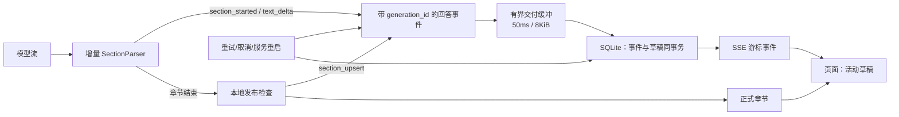

# 第 3 阶段报告：可恢复的正文增量交付

本阶段将“模型已经产生正文”与“章节已经完成校验”分开交付。Web 默认在 Writer 确认章节边界后立即显示正文增量，章节结束时再以经过轻量本地校正的正式内容原位替换草稿。CLI 保持原有章节输出，并新增仅供程序消费的 `--stream-events` NDJSON 模式。

验收日期：2026-10-14（Asia/Shanghai）。工作分支：`codex/stage3-stream-delivery`。起点提交：`82efc2e7a033da698a935673bca16a2e1e3bdb5f`。本报告本身属于阶段提交，可用 `git log -1 --format="%H %s" -- docs/refactor/03-stage3-stream-delivery.md` 获取对应的完整提交哈希。

本阶段没有修改检索停止条件、证据预算、模型角色、教学蓝图算法或模型调用数量。因此它解决的是“正文已到达却被整节等待挡住”的交付问题，不宣称取证、规划或回答质量已经提升。

## 1. 原有架构问题与改造边界

第 2 阶段后的链路已经有模型流、取消令牌、章节回调、SSE 和历史恢复，但完整章节仍是唯一公开单位：Writer 一边解析协议、一边验证标题和引用、一边调用 `on_section`；Web 收到回调后重建整篇 Markdown。这样首个正文必须等待 `<<<END_SECTION>>>`、本地检查和章节回调完成。

这会带来四个实际问题：

| 问题 | 原因 | 本阶段的处理 |
|---|---|---|
| 正文到达后仍长时间没有可见内容 | 生成、校验、发布被绑定成“完整章节” | 让协议解析器安全释放确认属于当前章节的正文，并发出正文 delta |
| 重试会在页面上叠加旧草稿 | 尝试没有稳定身份 | 每次 Writer 尝试都有新的 `generation_id`；新尝试取代旧预览，旧尝试仅留诊断/历史事件 |
| 未完成内容无法在刷新后恢复 | SQLite 只保存正式章节 | 保存活动生成、草稿、修订号和中断状态；刷新/SSE 重连从权威快照恢复 |
| 已传给 Writer 的证据仍可能被章节白名单删掉引用 | “推荐本节材料”被错误当成“唯一可引用材料” | 默认 Fast/Full 将 Writer 实际输入中非空的证据作为引用定位范围；章节标签仍是选材建议 |

成熟系统可用性较高，不只因为模型流式接口，而是因为它们把文本片段、完成版本、重试、持久化和客户端状态作为独立协议处理。本阶段也按这一边界拆分：协议解析器不依赖 Web；Writer 不依赖 SQLite；Web 只消费回答事件；页面只更新活动草稿，不反复重绘全部已完成答案。



正式章节仍是最终答案的权威来源。草稿的存在不会把失败或取消升级成成功；终态会保留草稿，并标注为未完成。

## 2. 固定开源参考与采用方式

参考清单位于 [03-reference-sources.json](03-reference-sources.json)，其中保存固定提交、路径、链接与 SHA-256。本地源码副本保存在被 Git 忽略的 `artifacts/refactor-stage3/references/`，本项目没有增加 Vercel AI SDK、Continue 或 LlamaIndex 运行依赖。

| 参考与固定版本 | 实际借鉴的机制 | 本项目适配与验证 |
|---|---|---|
| Vercel AI SDK `6ac1ee115c4e287be43ebb0e86d884033d85b0cd` | UI 消息流将文本表示为带身份的 start、delta、end 片段；处理器校验顺序、维护活动部件，并覆盖重试和非法流 | `generation_id + section_id + revision` 表示一个活动正文；客户端拒绝重复、缺口、过期生成和终态后 delta；本地与浏览器测试覆盖替换、重连和顺序错误 |
| Continue `5522c6f44ca0ac3528b37244818fbfa39b5af470` | 流式聊天将取消信号贯穿读取和生成器关闭，取消后不再继续消费生成内容 | 请求作用域绑定取消令牌；网络读取队列每 100ms 检查取消/期限，关闭时终止读取端、关闭管道并回收线程；取消不走普通模型重试 |
| LlamaIndex `5b7b6e323e1da3edd787a2104a89257c14f026d0` | CitationQueryEngine 将实际提供给生成器的来源整理为有编号的引用材料，并支持流式响应 | 引用可定位只对当前 Writer 输入中的真实非空证据成立；页面仅把正式章节里存在的来源变为可点引用；不把“来源存在”误写成“事实已认证” |

具体源码：[Vercel 事件类型](https://github.com/vercel/ai/blob/6ac1ee115c4e287be43ebb0e86d884033d85b0cd/packages/ai/src/ui-message-stream/ui-message-chunks.ts)、[Vercel 状态处理](https://github.com/vercel/ai/blob/6ac1ee115c4e287be43ebb0e86d884033d85b0cd/packages/ai/src/ui/process-ui-message-stream.ts)、[Vercel 测试](https://github.com/vercel/ai/blob/6ac1ee115c4e287be43ebb0e86d884033d85b0cd/packages/ai/src/ui/process-ui-message-stream.test.ts)、[Continue streamChat](https://github.com/continuedev/continue/blob/5522c6f44ca0ac3528b37244818fbfa39b5af470/core/llm/streamChat.ts)、[LlamaIndex CitationQueryEngine](https://github.com/run-llama/llama_index/blob/5b7b6e323e1da3edd787a2104a89257c14f026d0/llama-index-core/llama_index/core/query_engine/citation_query_engine.py)。

这些参考支持事件身份、增量状态和来源绑定的设计；它们不能证明所有成熟产品使用同一内部架构，也不能替代本项目对事实支持、检索覆盖或安全边界的验证。

## 3. 事件协议、状态与接口

新增独立的 `devcontext.delivery` 模块。它不导入 argparse、FastAPI、SQLite 或 Vue。`AskService.execute/ask` 增加可选的 `on_event`，既有 `on_section`、`on_evidence` 与观察器接口保持兼容；未订阅事件时不会启用 Web 缓冲或持久化路径。

| 事件 | 必填数据 | 含义 |
|---|---|---|
| `answer.generation_started` | `generation_id`、`path` | 一个 Writer 尝试开始；新身份替换活动草稿 |
| `answer.section_started` | `generation_id`、`section_id`、`position` | 当前章节边界已确认，可以接收正文 |
| `answer.text_delta` | `generation_id`、`section_id`、`revision`、`delta` | 已确认属于章节正文的可显示增量 |
| `answer.section_upsert` | 上述身份、`revision`、`markdown`、`citations` | 章节校验通过后的权威全文；替换相同章节草稿 |
| `answer.generation_finished` | `generation_id`、`status` | 一次尝试正常完成、部分完成或失败；仍在写的草稿标为中断 |

`SectionParser` 处理控制标记跨任意分片、中文和 Emoji，并只保留可能构成结束标记的尾部；控制标记、嵌套标记、错误顺序、额外内容及单节超过 200,000 字符均拒绝。Fast、Full 和 Full 的直接兜底都经由这一协议：直接兜底产生一个单正文片段，并同样先产生 delta、后提交正式内容。

本地发布检查分为三层：

1. 协议层严格验证章节身份、顺序、边界和终止状态，避免不同尝试正文混入。
2. 引用定位层默认 Fast/Full 使用实际 Writer 输入的可用标签；未知、畸形或未输入引用被移除并记录原因。兼容模式仍使用原章节白名单规则。
3. 轻量格式层把可识别的 Markdown 标题标准化为计划标题，保留正文。它不新增模型裁判调用。

因此，允许某条实际输入证据的引用，只说明链接能定位到来源，不表示相关项目断言已经由模型或人工核实。概念说明仍可无引用；事实支持继续依赖证据状态、缺口和后续人工/评测检查。

每次校验记录 `publication_check` 耗时和修正警告。第 1 阶段的已发布 Fast 章节本地重复校验微测为 19 节 × 200 次约 83ms，不能用它推断线上完整等待，但也没有证据支持“本地引用校验造成数十秒等待”的说法。

## 4. Web 交付、恢复和信息边界

Web 使用 `BufferedDelivery` 将模型写入与持久化解耦：队列最多 64 个片段，每片最多 4096 个 Unicode 字符。第一批可显示正文立即写入；后续正文最多合并 50ms，达到 8KiB 提前写入。消费者慢时队列施加背压，不丢弃正文；模型暂停时，已经到达的数据仍由独立调度器发布。

正文事件与草稿快照在同一个 SQLite 事务中完成，成功保存后才通知 SSE。SSE 空轮询只读取终态和游标，不为每个 delta 重载完整答案和证据。序号连续；客户端重复事件忽略，发现缺口则重新取得权威运行快照。

数据库 `user_version` 从 1 升至 2，新增 `run_generations` 和 `run_drafts`：

- 迁移前用 SQLite backup API 生成同目录 `*.v1-<uuid>.bak`；迁移事务提交后才写版本号。
- 老记录没有草稿，继续按既有章节显示。
- 服务重启将未完成运行改为 `partial` 或 `failed`，将草稿标记 `interrupted`；已完成章节仍保留。
- 旧程序不会读取版本 2 数据库。若要回退，停止新程序并用迁移前备份恢复数据库。

`DEVCONTEXT_WEB_STREAM_PREVIEW=false` 可以在同版本关闭 Web 草稿预览，恢复原有“只在完整章节回调时显示”的行为。该开关只影响 Web 预览，不改变正式章节、历史记录和结果状态。

发布前使用跨分片脱敏器处理应用配置中的密钥和 PostgreSQL/MySQL URL。它保留可能为密钥或 URL 开头的尾部，直至确认安全；流结束仍无法确认时写入 `[已隐藏]`，不会为保留普通文字而泄漏疑似密钥。公开事件不发送模型推理内容或原始供应商错误。

前端把正式章节与活动正文分开：草稿只更新自身，最多每 50ms 重渲染；完成章节保持稳定。草稿中的 `[E1]` 是普通文本，正式章节只在来源存在时生成可点击引用。Markdown 禁用原始 HTML，未闭合代码块可渲染，用户上滚时不会被强制拉回底部。复制未完成内容会加上“以下内容尚未完成”的提示。

CLI 默认行为不变；`devcontext ask ... --stream-events` 输出纯 NDJSON，供脚本消费。该模式仅适用 Fast/Full，并与调试、性能报告、重复运行、`--plan-only`、`--no-plan` 和 Legacy 冲突，避免事件流掺入人类可读日志。

## 5. 诊断与受控流式实验

阶段 1 的诊断快照、失败快照、未知用量、稳定引用与离线重放接口均保留。诊断新增 `first_body_published`，用于区分“模型提供正文”、“服务持久化首段正文”、“首节完成”和“请求结束”。`browser_first_visible` 仍不由服务端虚构；浏览器以自己的时钟记录 DOM 更新并在下一帧观察。

受控浏览器测试使用本地生成器：第一段正文输出后阻塞，直到页面确认草稿可见才释放章节结束标记。Fast 和 Full 均证明草稿先于正式章节出现，刷新后仍可恢复。两次受控运行的浏览器本地“提交到首段正文 DOM 更新”分别为 **204.4ms**（Fast）和 **327.6ms**（Full）。这些是本机、替身、单次测量，且 DOM 更新不等同真实屏幕绘制；没有与服务端时钟相减，也没有据此报告线上性能提升百分比。

离线验证脚本使用阶段 1 的六份冻结 Writer 输入，以本地文本生产者对比起点提交与当前交付路径。它不检索、不调用模型、不调用裁判：六份样本共 18 个对照都通过，外部调用为 0。对照验证了未改变的输入/章节结果、首个 delta 早于提交、跨节但已实际输入的引用保留，以及标题标准化这两项有意差异。

阶段 1 的 S1-04 原始样本未重跑、未覆盖。其说明已更正为：首次 Writer 尝试约 13.6 秒，没有正文，错误为 `missing or unclosed section`；此前“Planner 格式恢复”的归属不准确。这不能归因于本地引用校验。

## 6. 测试与验收结果

| 验证 | 结果 | 覆盖范围 |
|---|---|---|
| 新增 Python 交付测试 | 纳入全套通过 | 任意标记分片、中文/Emoji、多节、错误顺序、长度上限、输入范围引用、标题校正、重试替换、直接兜底、尾部脱敏、背压、取消读取、迁移、事务、CLI NDJSON、预览开关 |
| 全套 Python | **898 passed / 11 skipped**，21.64s | 回答、取证、诊断、评测、Web 和新增流式回归 |
| 前端单元测试 | **3 files / 11 passed** | 事件连续性、重复/缺口/过期事件、草稿替换、Markdown 引用与 HTML 边界 |
| 前端类型检查与构建 | **通过** | `vue-tsc -b` 和 Vite 生产构建 |
| 浏览器端到端 | **6 passed** | Fast/Full 受控首段显示、刷新恢复、取消草稿/复制、历史和证据、失败/部分状态、断网继续运行与移动布局 |
| 六份冻结快照离线对照 | **6 snapshots / 18 cases passed** | 新旧 Writer 固定输入对照，外部调用为 0 |

11 个跳过项均要求启动 PostgreSQL 集成环境或显式设置 `DEVCONTEXT_RUN_INTEGRATION=1`。本阶段按照约束没有重新索引、没有写入知识库、没有新增真实模型采样。它们是未执行范围，不能记为通过。

可复现命令：

```powershell
uv run --extra dev --extra web pytest -o addopts= -q -ra
uv run --extra dev --extra web python scripts/verify_refactor_stage3.py
Set-Location frontend
npm test
npm run build
npm run test:e2e -- --reporter=list,json
```

后两项浏览器测试需要 8000/5173 端口可用，并使用本地 Web/模型替身。完整冻结请求、离线结果、浏览器 JSON、参考源码、构建目录与截图位于忽略目录 `artifacts/refactor-stage3/`、`frontend/test-results/`、`frontend/dist/` 和 `frontend/node_modules/`，不包含在提交中。

## 7. 提交范围、限制与下一阶段

本阶段提交包含交付事件模块、Writer/解析器与引用边界、应用服务事件入口、有界网络/交付缓冲、Web SQLite v2 迁移和 SSE、Vue 草稿显示、CLI NDJSON、受控替身与测试、参考清单、离线验证脚本及本报告。原有未跟踪的历史文档、Visio 文件、`trace.json` 和纯 LF/CRLF 状态不纳入本阶段提交。

已解决：模型正文产生后等待完整章节才显示；重试重复正文；断线/刷新丢失活动正文；取消后继续写晚到正文；实际 Writer 输入内证据被章节白名单误删引用；无界网络读取队列和取消响应迟缓。

仍未解决：检索完成后的独立规划与教学蓝图等待、关键调用方法证据缺失、证据进入 Writer 的预算截断、过强项目保证、跨章节重复、真实模型在复杂问题上的教学组织质量，以及全链路网络/同步规划立即取消。这些问题不能用提前显示草稿或放宽引用定位来代替解决。

下一阶段应重新分析回答引擎：用阶段 1 的冻结证据比较“复杂教学蓝图 + 修正调用”与更直接的回答编排，确认哪些结构约束应保留在提示、哪些应转为离线评测，并单独测量规划等待、模型首正文和首节完成。第 3 阶段到此结束，不自动实施该重构。
