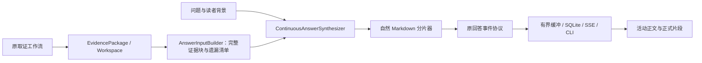

# 第 4 阶段报告：证据交接与连续回答引擎

日期：2026-10-14（Asia/Shanghai）。工作分支：`codex/stage4-continuous-answer`。基线：`7b7ffbf33f5cab5271b473263787435f059082a9`。

本阶段新增独立证据输入与连续回答生成器。选材不依赖模型先生成的教学目录；Fast/Full 候选从实际证据直接进行一次自然 Markdown 写作，模型不承担章节传输协议。本报告对应提交可用 `git log -1 --format="%H %s" -- docs/refactor/04-stage4-continuous-answer.md` 定位。

**实施与技术验收完成；真实质量门槛未全部达到，默认仍为 `planned`。** 六题中确认三题在时序、解释或证据边界上改善，未达到至少四题的要求，且购票强保证仍有无证据外推。连续引擎作为可配置候选保存，没有在失败后静默切回，也没有把未达到质量门槛描述为上线成功。

## 1. 架构问题与采用的设计

原六题记录显示回答前依次经过证据规划、Agent 动作、Coverage 和独立教学规划；S1-05 共九次模型调用，取证后 Writer 仅剩少量时间。旧 Fast 的材料绑定依赖章节规划，S1-02 已取到的 Controller.register E9 未进入 Writer；复杂 Full 蓝图还要求 Claim、学习目标、因果骨架、检查点和章节契约合法。这些机制不单独认证事实支持，却增加了串行调用、提示与格式恢复成本。

本阶段把回答组织交给一次 Writer 调用，将来源、预算、终态、引用定位、取消、脱敏和恢复作为程序约束保留。正常回答不调用独立 Micro Planner/TeachingPlannerV3，也不调用逐节裁判。旧教学原则改为生成指令与离线核查项：直接回应、必要概念、动作/状态/原因/条件、相关失败分支、具体但明确是假设的例子，以及避免重复。

这项改造减少了一次独立教学规划的必经依赖；真实模型 Writer 自身的推理、服务负载与输出长度仍影响等待。本阶段不改检索决策和工具预算，不声称所有端到端请求更快。



## 2. 固定参考与适配

[04-reference-sources.json](04-reference-sources.json) 保存 17 个固定源码文件的版本、路径、URL、SHA-256 和本地位置，原文位于 `artifacts/refactor-stage4/references/`。没有引入这些框架作为运行依赖。

| 参考 | 阅读模块及测试 | 采用与舍弃 |
|---|---|---|
| Onyx v1.0.0 `103300798fa31186794ff1733bc07dc99341f2b7` | Answer、AnswerPromptBuilder、citation 预算、basic graph、use_tool_response、test_answer | 工具最终材料直接进入流式回答；正文、引用与终止独立。保留本项目断网不取消和 SQLite 恢复，未照搬其断线取消或整个图框架 |
| LlamaIndex `5b7b6e323e1da3edd787a2104a89257c14f026d0` | SimpleSummarize、CompactAndRefine、test_simple_summarize | query+证据进入可重放 synthesize 边界，测试检查实际模型消息与 stream_chat。未采用静默截断和多次 refine，因为代码证明链与首正文等待需要显式管理 |
| OpenAI Agents SDK v0.4.2 `a30c32e722a4cdb761fe8b250606757ec8581296` | run、_run_impl、普通与流式 agent_runner 测试 | 受控工具循环和 final-output/continue 边界作为第 5 阶段依据；本阶段保留现有检索和模型协议，不加入多 Agent 或 SDK |
| Continue `5522c6f44ca0ac3528b37244818fbfa39b5af470` | retrieval 入口、Base/Reranker/NoReranker 管线 | 检索候选、去重与实际上下文分开。未照搬吞掉异常或按候选前缀截取，也未新增模型 rerank 调用 |

来源：[Onyx 工具结果到回答](https://github.com/onyx-dot-app/onyx/blob/103300798fa31186794ff1733bc07dc99341f2b7/backend/onyx/agents/agent_search/orchestration/nodes/use_tool_response.py)、[Onyx 回答测试](https://github.com/onyx-dot-app/onyx/blob/103300798fa31186794ff1733bc07dc99341f2b7/backend/tests/unit/onyx/chat/test_answer.py)、[LlamaIndex 生成器](https://github.com/run-llama/llama_index/blob/5b7b6e323e1da3edd787a2104a89257c14f026d0/llama-index-core/llama_index/core/response_synthesizers/simple_summarize.py)、[Agents SDK 循环](https://github.com/openai/openai-agents-python/blob/a30c32e722a4cdb761fe8b250606757ec8581296/src/agents/run.py)、[Continue 上下文入口](https://github.com/continuedev/continue/blob/5522c6f44ca0ac3528b37244818fbfa39b5af470/core/context/retrieval/retrieval.ts)。

OpenAI 官方延迟指南建议减少串行请求、合并步骤并流式显示。它支持本阶段的设计方向，但没有公开 ChatGPT 完整内部架构，也不能替代本项目效果验证。[官方延迟建议](https://developers.openai.com/api/docs/guides/latency-optimization)

## 3. 公共接口与数据流

新增 `devcontext.synthesis`：

- `AnswerInputBuilder.build(request, package, budget)`：无模型调用，构建实际写作输入。
- `AnswerInput.to_dict/from_dict`：版本 1 JSON 边界，保留原文、稳定标签、来源属性、取证状态、缺口、关系、选材与预算。
- `AnswerSynthesizer.synthesize(request, answer_input, on_event=None, on_section=None)`：独立回答接口。
- `ContinuousAnswerSynthesizer`：正常路径一个模型调用；只有尚无可见文本的可恢复传输错误最多再尝试一次。已显示正文后不自动重写，取消与交付错误不进入模型恢复。
- `WorkflowFactory.build_answer_synthesizer`：公共模型组装；`ContinuousAnswerWorkflow` 将新结果适配为既有 TeachingAnswerResult 和 AgenticAnswerResult。

配置为 `ANSWER_SYNTHESIS_MODE=planned|continuous`，CLI/Web 共用 Settings。`continuous` 时默认 Fast/Full 不构建独立教学 Planner；显式 `--teaching-generation-mode single_stream/v3/multi_pass` 使用原兼容路径。`--profile` 和推理、预算规则继续有效。当前页面不增加实现方式选择，部署者通过配置选择引擎。

使用方式：

```powershell
$env:ANSWER_SYNTHESIS_MODE = 'continuous'
uv run devcontext ask "详细解释项目为何采用责任链校验。" --profile fast
uv run devcontext ask "订单与车票是否在同一数据库事务中提交？" --profile full --stream-events
uv run --extra web devcontext-web
```

将配置设回 `planned` 即使用旧 Fast/Full。Web 草稿预览仍由 `DEVCONTEXT_WEB_STREAM_PREVIEW` 控制，本阶段未升级 SQLite 版本。

## 4. 选材、交付与诊断规则

选材使用 Workspace 全量原文；无 Workspace 时保留 ContextBundle 的已有截断标志。保持标签与 chunk 身份，不重新编号。CORE 需求轮流选择；需求内优先已确认符号端点、明确指定符号与当前代码，同级考虑权威和检索排名。预算允许时保留全部候选，超限跳过整块而不截正文，并继续检查后续候选。

实际系统提示、问题、证据、来源、关系、Coverage 与选材元数据都计入 TokenBudgetPolicy；Fast/Full 输出预留沿用 16000/32768 上限。显式 max_chars 是证据渲染的额外上限。遗漏原因包含 empty、max_chars、token_budget、metadata_budget；旧 READY 原样保留，并通过遗漏、截断和端点材料标记限定实际输入，不能将状态当作事实认证。

关系端点使用 evidence_in_input / evidence_untruncated 标记实际输入的片段；“片段未截断”不等于“方法实现完整”。例如一个未截断的类摘要仍可能只列方法签名，因此不使用 body_complete 字段给它作实施完整性背书。

模型只输出自然 Markdown。局部分片器在代码围栏之外发现二级标题时提交前一片段；首段可以没有标题和换行，确认普通正文后立即发送 delta。无标题答案在正常结束时提交；异常结束保留活动草稿。来源校验只处理正文，围栏和行内代码里的类似 [E1] 不被修改。未知引用清理记录警告，标题不需匹配计划。

修复了阶段 3 已复现的脱敏边界：疑似密钥尾部在片段提交之前处理并移除对应脱敏器；generation_finished 不再向已提交片段补发尾部。CLI 与 Web 同步修正，慢存储与交付失败仍通过 DeliveryError 退出，不能触发重新生成。

阶段 1 诊断继续可选，关闭时不序列化新证据包。开启时新增 answer_input，模型实际请求、正文里程碑和未知用量继续保留。Web 运行摘要只加入实际 synthesis_mode，不暴露原文请求、推理或原始供应商错误。

诊断另外保存带相对时间的 answer_events，即使没有 Web 订阅者也能保留中断正文。诊断保存前同样进行跨分片脱敏。模型首正文、首正式片段和服务持久化是不同边界；连续引擎的性能字段使用请求起点，不能把 Writer 局部起点当成整次请求起点。

## 5. 验证与真实对照

六份 Workspace 离线重放均通过，外部模型/检索调用为 0。原文与稳定标签往返保留，每次本地正常回答只调用一次 Writer。

| 样本 | 从旧 Writer 选材遗漏中恢复的标签 |
|---|---|
| S1-01 | 无，旧侧已选入全部 20 条 |
| S1-02 | E9、E11 |
| S1-03 | E2 |
| S1-04 | 无 |
| S1-05 | E4、E5、E6、E7、E8、E9、E10、E12、E13、E14、E15、E18、E21、E23 |
| S1-06 | E3、E5 |

恢复材料只说明交接保留，不证明这些材料都与问题高度相关，更不能补回原检索从未取得的关键方法正文。完整选材清单在 `artifacts/refactor-stage4/offline-verification.json`。

浏览器受控生成器先输出无标题、无换行的第一句，然后暂停；浏览器确认可见并刷新恢复之后，才允许输出第二标题。随后再次暂停，检查已提交首片段稳定，最后释放结束。Fast/Full 的自然 Markdown、围栏内标题、未知引用、取消与复制均通过。

真实实验执行范围为六题、新旧各一次，最多 12 次 Writer 请求；没有重新规划、检索、预热、重跑、Full 或裁判调用。旧计划从历史快照恢复，两侧证据原文和标签完全相同，使用 deepseek-flash / Fast / low / 16000 输出上限，各次显式总期限 120 秒。各题交替调用顺序。

真实生成均正常结束：十二次实际 Writer 请求，六次旧侧、六次新侧，每次只有一个模型 attempt。S1-05 原证据状态仍为 PARTIAL，生成 complete 不会将它升级成 READY。以下秒数从各次独立 Writer 实验起点计，不包括取证或恢复旧计划前的历史规划时间。

| 样本 | 旧首正文 / 旧结束秒 | 新首正文 / 新结束秒 | 旧 / 新首正式片段秒 |
|---|---|---|---|
| S1-01 | 1.90 / 11.46 | 22.45 / 28.87 | 3.89 / 23.04 |
| S1-02 | 14.52 / 22.28 | 45.56 / 54.60 | 15.95 / 46.36 |
| S1-03 | 18.76 / 31.33 | 34.47 / 46.67 | 22.30 / 35.05 |
| S1-04 | 20.07 / 27.43 | 26.93 / 34.83 | 21.96 / 27.58 |
| S1-05 | 21.98 / 25.44 | 25.94 / 31.81 | 22.63 / 26.38 |
| S1-06 | 2.87 / 5.98 | 1.97 / 5.74 | 5.92 / 2.60 |

该实验只记录模型正文与本地分片事件，没有 Web 持久化/浏览器订阅，first_body_published 和 browser_first_visible 保持未测量。浏览器显示由独立受控实验验证；不能用首片段时间代替首次屏幕绘制。

新 Writer 在前五题更慢，不能宣称性能提升。供应商上报的推理用量也较大：S1-02 新侧 reasoning_tokens=7284、旧侧=2475，虽然两侧都请求 low。这与更晚正文相伴，但单次样本不能证明具体因果或稳定规律。新输入还携带来源、需求、Coverage 和选材信息，部分与证据头重复；S1-01 新侧 prompt_tokens=8304、旧侧=5605，移除规划不等于提示和模型内部组织成本同时下降。

逐题实施者核查见 [04-stage4-review.json](04-stage4-review.json)。先读取交换排列的 A/B 文本并核对冻结原文，随后读取模式映射；这是实施代理的逐题审阅，没有独立人类评审或模型裁判，不能称为独立盲评认证。

| 样本 | 本次观察 | 新侧明确改善 |
|---|---|---|
| S1-01 | 新侧对历史材料更谨慎，但加入题目未问的事务/并发/缓存整节；整体解释仍不够集中 | 否 |
| S1-02 | 新侧有注册假设例子，仍重复证据止点与三类额外技术主题；旧侧的采用条件更直接 | 否 |
| S1-03 | 新侧明确 token 先于加锁，说明关键事务方法缺正文；补偿分支和本地原子性的强结论仍不充分 | 是，有限制 |
| S1-04 | 新侧正常时序较准确，避免把一次历史回归认证全部部署；仍未取得具体数据库裁决 | 是，有限制 |
| S1-05 | 新侧区分关单注释与完整支付编排，说明零行可能已处理，原子性限定较清楚 | 是 |
| S1-06 | 新侧给出缩略文件和行号，但定位问题仍扩展为事务/并发/缓存未知清单 | 否 |

检查表来自冻结六题清单和已批准计划。每项核心解释按0/1/2记录覆盖，旧侧总计27、新侧29；该分值不是事实正确性的认证。明确改善3题，未达到至少4题。没有来源越界标签清理警告，仍存在无证据保证，说明合法引用不能代替事实支持。

默认选择为 `planned`。后续应通过统一任务理解限制默认读者背景的扩展范围，避免“需要解释本题必要的事务、并发和缓存”被模型理解成每题固定三类主题；同时减少重复元数据，并补齐具体裁决和补偿证据。没有为改善这批结果追加采样或事后重写样本。

采样代码哈希和配置白名单保存在 live Manifest。采样后仅补充输入恢复校验、Markdown代码围栏/行内代码边界、请求起点计时、失败正文诊断与相应测试，没有更换 Writer 提示、读者背景或模型参数；没有重新生成。真实对照使用原证据包，结构元数据未额外加入任一侧；生产新选材仍只经过离线核查，未做真实端到端质量验证。

验收结果：

| 验证 | 结果 |
|---|---|
| 新增连续回答测试 | 55 passed，包括并发取消/配置/诊断隔离 |
| 全套 Python | 953 passed / 11 skipped，18.93s；端点元数据命名澄清后55项新测试及六份离线重放再次通过 |
| 前端单元 | 3 files / 11 passed |
| 前端类型检查及构建 | 通过 |
| 浏览器端到端 | 9 passed，32.3s |
| 六份新证据包离线重放 | 6/6，外部调用0 |
| 阶段3交付对照 | 6份快照 / 18个对照通过，外部调用0 |
| 额外阶段2旧基线检查 | 当前Fast的系统提示因阶段3引用范围调整而不同；答案、证据和状态一致，Full/Legacy一致。差异报告另存本阶段目录；阶段2保存的组装版本重放仍通过 |

最后一项不是失败忽略：旧阶段2脚本比较的是整合提交的模型消息，当前系统提示新增了阶段3授权的引用边界，因此 Fast 的严格消息相等为 false。已经定位唯一变化为 Writer system 消息；没有将该条消息比较写成通过，也没有修改冻结脚本放宽判断。

## 6. 复现、提交与下一阶段

```powershell
uv run --extra dev --extra web pytest -o addopts= -q -ra
uv run --extra dev --extra web python scripts/verify_refactor_stage4.py
uv run --extra dev --extra web python scripts/fetch_refactor_stage4_references.py
# 真实实验需独立空目录；同目录有样本时拒绝覆盖或自动重跑。
uv run --extra dev --extra web python scripts/run_refactor_stage4.py --output artifacts/refactor-stage4/new-experiment
Set-Location frontend
npm test
npm run build
npm run test:e2e
```

真实脚本最多十二次请求、无额外模型恢复。完整请求、证据与回答、采样 Manifest、隐藏引擎标识的 review-pair、映射 review-key、参考源码和截图位于忽略目录，不纳入提交。11 项 PostgreSQL 集成测试按计划未开启，未重索引或写知识库。

提交范围包括新 synthesis 模块、应用层组装与配置、原 Writer 的实验次数上限参数、脱敏交付修复、诊断与摘要、测试、离线/真实验证脚本、固定参考与说明。既有 27 个测试文件的纯换行状态、历史未跟踪文档、Visio 和 trace.json 继续原地保留。

下一阶段先重新分析证据 Planner、Agent Planner 和 Coverage 的重复决策，设计有明确预算与事实边界的统一取证循环。其后再分析关键被调方法、SQL、事务和跨服务端点的获取能力；不能用更自然的回答、更多输入或合法引用代替具体保证的证据。本阶段提交后停止。
