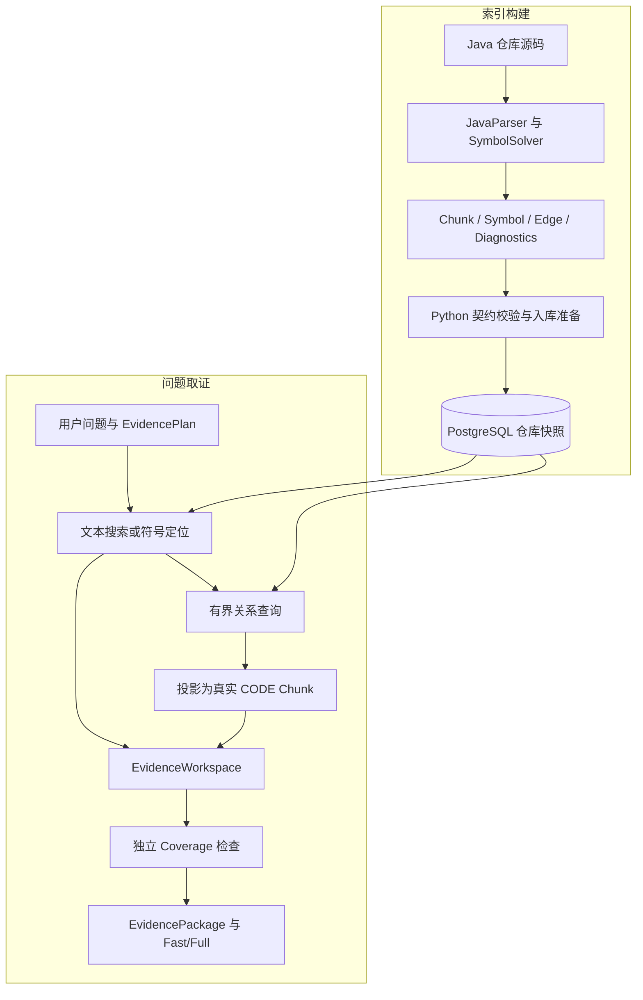
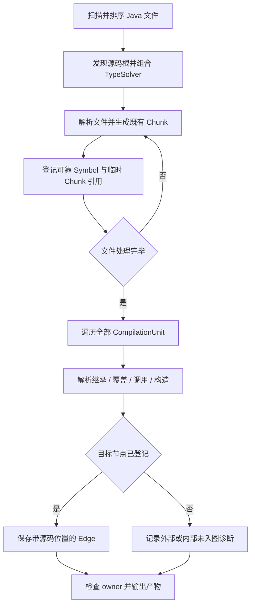
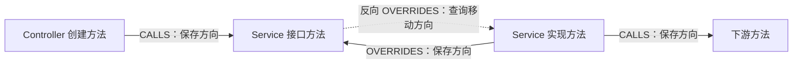
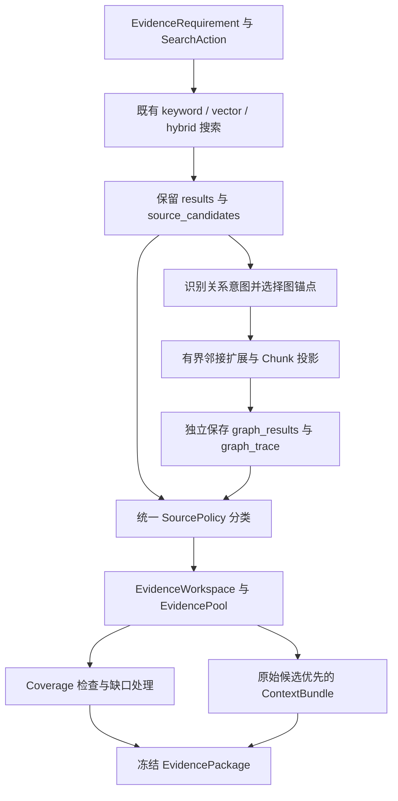

# 代码符号图实现与设计思想详细解读

> 面向读者：已经理解 Chunk、基础 RAG 检索和 EvidencePlanner，希望进一步理解“源码之间的关系如何成为回答证据”的学习者。
>
> 源码核对日期：2026-10-07。实现基于当前 `main`，功能提交包括 Symbol Graph V1 与 Tool-driven Retrieval Agent V1。本文重点解释设计动机、层间协作和能力边界；评测数字引用已有验收记录，本次编写没有重新执行建图、模型调用或评测。

## 一、符号图解决什么问题

### 1.1 找到相关代码，与找齐相关代码，是两个问题

用户问“创建订单从 Controller 经过哪些服务，最后怎样投递延迟关闭任务”，向量搜索可能找到订单创建方法，关键词搜索可能找到包含 `createTicketOrder` 的接口声明。它们已经找到了相关文本，但回答仍可能缺少两个环节：接口由哪个方法实现，以及实现体调用了哪个下游组件。

这个缺口来自检索依据与程序组织方式之间的差异。相似性检索按照文本相关程度排序，而 Java 代码通过类型、声明、调用和继承组织。两个方法可能业务联系紧密，却使用不同名字；一个接口和多个实现可能文本相似，但承担不同运行职责。提高 top-k 有时能找到更多材料，也会同时引入工具类、测试代码和相似模块，并不能明确解释候选为什么有关联。

符号图补充的是结构信息：当前命中的实体是谁，它与哪些可靠定位的源码实体存在何种关系。搜索先帮助找到调查入口，关系查询再帮助跨越命名差异和文件边界。两者相互补充，原有检索仍负责处理自然语言、设计理由和没有进入图的源码。

| 能力 | 判断依据 | 适合解决的问题 | 单独使用的局限 |
|---|---|---|---|
| 文本检索 | 关键词、向量与排序策略 | 哪些片段与业务问题相关 | 相似并不意味着存在程序关系 |
| 符号定位 | 名称、所属类型、完整签名 | 这个类或方法具体是谁 | 定位一个声明不等于补齐执行过程 |
| 关系查询 | 已解析的节点和边 | 谁调用它、它调用谁、谁实现它 | 索引缺口和静态分析边界会限制覆盖 |
| Coverage 检查 | 需求及已取得的证据 | 当前证据是否满足回答条件 | 判断本身仍可能错误，需要独立评测 |

### 1.2 图的目的，是帮助取证

当前项目围绕 EvidenceRequirement 组织调查。需求可能是“证明订单入口调用了订单服务”，也可能是“找到订单关闭的触发机制及设计理由”。符号图能帮助前者取得跨文件源码；对于后者，图只能补充代码关系，理由仍可能需要文档。

因此，关系查询结束后还要执行一项关键转换：把 Symbol 投影回真实的 CODE Chunk。Chunk 包含可交给模型阅读的正文、来源文件和代码位置，才能进入 EvidenceWorkspace、被 CoverageChecker 检查并进入回答上下文。关系路径是“为什么找到这个片段”的解释，片段本身是“据此能说什么”的依据。

这使项目保持一套证据模型。Fast/Full 不必各自理解一套图节点格式，也不必把图关系直接当作最终答案；它们继续消费 EvidencePackage。图增强改变取证方式，回答层仍从受管理的材料中作答。

### 1.3 首版优先保留可信关系

一个容易想到的方案是按方法名或参数数量匹配调用目标。例如看到 `service.save(x)`，就连向所有名为 `save` 的方法。这样容易得到更多边，但边可能连到错误模块、错误重载或完全不同的类型。一条错误边会继续扩出多个无关节点，错误会沿路径放大。

当前实现要求先通过解析建立可靠身份，再保存能够解析且端点已经入图的关系。无法解析时记录诊断，不以名字相似补边。这意味着图可能不完整，但已保存关系的依据更清楚。对回答系统而言，缺少证据可以表达为缺口；看似精确的错误路径则更容易制造错误确信。

这里要同时理解两件事：当前实现以可靠定位为目标，但这个目标不自动证明所有边都正确；而缺边也不能证明关系不存在。关系正确性要靠源码测试，关系覆盖要靠真实依赖与基准案例检查。

## 二、整体架构与两条数据链路

### 2.1 先建索引，再按问题使用索引

符号图有离线建图和在线取证两条链路。前者对仓库源码做相对昂贵的扫描和语义解析；后者针对一个问题执行有限的定位和邻接查询。在线流程没有临时为每个问题重新分析整仓库，也没有让模型自行创造图关系。



图中 Diagnostics 是分析结果的一部分，但逐条缺口保存在本地产物中，当前没有专门的诊断数据库表。数据库保存 Chunk、Symbol 和 Edge。把“产生诊断”与“所有产物都持久化到同一张表”区分开，才能正确理解实现。

### 2.2 每层只承担适合自己的责任

Java 侧已经使用 JavaParser 提取源码片段，适合继续承担 AST 遍历和 Java 类型解析。Python 侧负责检索、证据管理和工作流，适合承担跨语言契约验证、落库和消费。数据库负责身份约束、引用完整性、事务和查询，控制器负责按需求决定何时扩图。

| 层 | 输入与输出 | 核心责任 |
|---|---|---|
| Java 分析器 | 源码 → 四类分析产物 | 提取声明、解析身份和关系、记录缺口 |
| Python Runner 与模型 | JSONL/JSON → 受校验对象 | 防止跨语言结果错位、失真或引用非法 |
| Ingestion 与存储 | Chunk/向量/图 → 仓库快照 | 同批更新证据与结构，失败回滚 |
| Graph Store | 标识与方向 → 节点/关系/Chunk | 隔离仓库、限制查询、保持读一致性 |
| 自动扩展或 Agent | 需求与调查上下文 → 新证据 | 决定使用哪些关系，控制扩展成本 |
| Workspace 与 Coverage | 需求相关证据 → 覆盖状态 | 统一管理证据和缺口，不由图自行宣布完成 |

这种分工让问题更容易定位。没有关系，可能是解析缺口；查错方向，可能是查询策略；图查到了片段却没进入答案，可能是上下文预算；材料不够却被判 READY，可能是 Coverage。不能把所有问题都归到“图效果不好”。

### 2.3 两种在线使用方式共用底层

固定 RetrievalController 在原始搜索后运行 CodeGraphExpander。它按规则识别意图，自动补充相关片段。Tool Agent 则把符号定位和关系查询作为明确的只读工具，由 Planner 选择下一步动作。

它们都读取同一个符号索引，但不会在一次 Agent 取证中叠加自动扩展。否则模型的一次搜索可能隐含产生额外图查询，难以解释动作、预算和收益。当前工厂在启用 Agent 时直接选择 ToolDrivenRetrievalController，自动 expander 只属于固定检索路径。

源码入口：[CLI 控制器构造](D:/Java-learning/DevContext/src/devcontext/cli.py:622)、[Java 分析器](D:/Java-learning/DevContext/java-parser/src/main/java/io/devcontext/parser/RepositoryJavaAnalyzer.java:33)、[入库流程](D:/Java-learning/DevContext/src/devcontext/ingestion/pipeline.py:24)。

## 三、Chunk、Symbol、Edge 与稳定身份

### 3.1 三种数据回答三种问题

Chunk 回答“可阅读、可引用的材料是什么”；Symbol 回答“这个程序实体是谁”；Edge 回答“两个已知实体之间有哪些已解析关系”。三者分开，使图索引可以复用原有材料而不重新制造一套正文。

不是每个 CODE Chunk 都有 Symbol。无法可靠解析签名的方法，或者当前不支持其所属类型的声明，可以保留原 Chunk 以供文本检索，却不入图。反过来，每个入图 Symbol 必须关联一个对应 CODE Chunk，关系端点也必须是已存在的 Symbol。

类型 Chunk 还有一个容易忽略的特点：JavaSourceParser 生成类或接口的摘要，包括声明、字段以及方法签名；它并不把所有方法实现体都复制进类型摘要。方法和构造器另有独立 Chunk。因此，找到类节点不能替代找到具体方法的执行体。

源码依据：[Chunk 构造](D:/Java-learning/DevContext/java-parser/src/main/java/io/devcontext/parser/JavaSourceParser.java:52)、[CodeSymbol 与 SymbolEdge](D:/Java-learning/DevContext/src/devcontext/code_graph/models.py:18)。

### 3.2 四类节点和五类边

| 节点种类 | 表示的实体 | Key 前缀 | 与证据的关联 |
|---|---|---|---|
| CLASS | 可靠定位的类声明 | `T:` | CLASS Chunk |
| INTERFACE | 可靠定位的接口声明 | `T:` | INTERFACE Chunk |
| METHOD | 方法声明或实现 | `M:` | METHOD Chunk |
| CONSTRUCTOR | 显式构造器声明 | `C:` | CONSTRUCTOR Chunk |

CLASS 与 INTERFACE 都属于类型身份，区别由 `symbol_kind` 表示。方法身份还包含所属类型和参数签名。拥有者通过 `owner_symbol_key` 表达，入库后再转换为 `owner_symbol_id`。类型拥有者主要用于嵌套声明，不等于 EXTENDS 关系。

| Edge 类型 | 保存方向 | 含义 | 反向查询的含义 |
|---|---|---|---|
| EXTENDS | 子类 → 父类，子接口 → 父接口 | 声明的继承关系 | 已索引的子类型 |
| IMPLEMENTS | 类 → 接口 | 类型实现接口 | 已索引的实现类 |
| CALLS | 方法/构造器 → 方法 | 调用点解析到的静态声明 | 已索引调用者 |
| CONSTRUCTS | 方法/构造器 → 构造器 | 显式对象创建定位到构造器 | 已索引构造调用来源 |
| OVERRIDES | 实现/覆盖方法 → 祖先方法 | 满足覆盖兼容条件 | 已索引实现或覆盖候选 |

IMPLEMENTS 是类型级关系，OVERRIDES 是方法级关系。类实现了某接口，不代表在这个类中能找到接口每个方法的显式实现；方法可能继承自父类，也可能因解析缺口未入图。需要执行体时，应查询方法级关系并检查真实代码。

### 3.3 不能只用简单名识别方法

下面是解释身份规则的教学示例，不是本仓库业务源码：

```java
package demo;
class OrderService {
    void save(String id) {}
    void save(Long id) {}
    OrderService(String name) {}
}
```

对应身份分别是：

```text
T:demo.OrderService
M:demo.OrderService#save(java.lang.String)
M:demo.OrderService#save(java.lang.Long)
C:demo.OrderService#<init>(java.lang.String)
```

完全限定所属类型区分跨包同名实体，参数类型区分重载，前缀和 `<init>` 区分构造器。可调用实体的 `qualified_name` 不包含参数，而 `canonical_signature` 保存方法名与参数部分，二者组合形成 Key。返回类型不用于区分重载；Java 的方法声明身份也不能靠仅有返回类型差异区分。

泛型签名使用声明参数类型的擦除结果。例如 `List<String>` 在身份中使用 `java.util.List`。数组和可变参数经过解析器提供的类型表示归一化。这里是在构造可重复的声明身份，覆盖判断仍要利用祖先泛型替换，不能把“身份使用擦除”理解为“覆盖时忽略泛型”。关键代码为：

```java
declaration.formalParameterTypes().stream()
    .map(t -> t.erasure().describe())
    .collect(Collectors.joining(","));
```

源码依据：[callableKey](D:/Java-learning/DevContext/java-parser/src/main/java/io/devcontext/parser/RepositoryJavaAnalyzer.java:159)。

### 3.4 自然身份、临时引用、数据库 ID

| 标识 | 生命周期 | 用途 | 是否适合长期记忆 |
|---|---|---|---|
| repository + symbol_key | 声明身份不变时可复用 | 唯一识别仓库内实体 | 可以，但重命名和签名变化会改变身份 |
| chunk_ref | 一次分析结果内 | 指向本批 Chunk 列表下标 | 不可以 |
| code_symbol.id / chunk_id | 当前数据库快照 | 外键和查询连接 | 不可以，重建后可能变化 |

`chunk_ref` 是跨语言传输的关联方式：Java 输出第几个 Chunk，Python 就把对应新数据库 ID 关联给 Symbol。它省去了用正文或行号模糊匹配的风险，但要求声明遍历顺序与 Chunk 生成顺序严格一致，且入库之前必须检查对应类型、文件及范围。

自然身份也有作用域。两个模块若在同一仓库声明同一个完全限定类型，当前设计不会把模块路径自动加入身份以绕过冲突，而是视为重复身份错误。这样更保守，也提示源码根配置不能混入彼此独立却重名的工程。

## 四、为什么采用两阶段仓库分析

### 4.1 单文件 AST 足以识别写法，不足以确认目标

AST 能告诉程序某处写了 `orderService.createTicketOrder(requestParam)`，并找到它的源码位置。但仅凭这一段语法，很难判断 `orderService` 的声明类型、调用匹配哪个重载，以及目标声明是否在另一个模块。

RepositoryJavaAnalyzer 从整个仓库发现所有 `src/main/java` 源码根，将每个根加入 CombinedTypeSolver，再加入 ReflectionTypeSolver。源码 Solver 用于解析仓库声明，ReflectionTypeSolver 补充其可见运行类，典型是 JDK 类型。当前没有自动下载业务 Maven 依赖，也没有把所有业务 Jar 配成完整构建 classpath。

JavaParser 和源码 TypeSolver 使用共享 ParserConfiguration，并安装 JavaSymbolSolver。这个共享配置尤其影响 Solver 内部再次解析源码时能否继续进行类型解析。已有 record getter 测试验证这一配置问题；它不意味着 record 已成为图中的完整类型节点。

### 4.2 第一阶段登记实体，第二阶段建立关系



若扫描到一个调用就立刻建边，目标文件可能尚未处理，程序无法区分“稍后会出现的节点”和“根本没有节点”。先完成实体登记，第二遍再解析关系，使端点存在性可以在完整的可靠符号集合上判断，不依赖文件遍历先后顺序。

需要精确理解的是，第一阶段内部仍逐文件生成 Chunk 和登记 Symbol，不是先把整个仓库每个 AST 都建立好以后才登记所有符号；TypeSolver 可以按需读取其他源码。两个阶段的分界是：所有文件的可靠节点登记完成后，才遍历所有已成功解析文件提取关系。

### 4.3 保留原有 Chunk，增加结构索引

分析器复用 JavaSourceParser 的 Chunk 提取方法。类型、方法、构造器的遍历顺序一致；若声明数量与 Chunk 数量不一致，会抛出分析契约异常，而不是继续把可能错位的下标写出。

对每个声明，分析器尝试创建 Symbol。类型要有可靠完全限定名；方法和构造器要有已登记拥有者，并能解析声明参数类型。缺少业务依赖时，某个方法签名可能无法解析，但原 Chunk 仍加入分析结果。这样的分离保留了搜索能力，也避免以不完整类型字符串构造“看似稳定”的身份。

这体现渐进式增强：基础材料保留下来，只有满足结构可靠性条件的部分加入图。图索引的覆盖率可以低于文本索引覆盖率，不需要为了形式上完整而猜测缺失的节点。

### 4.4 跨语言边界也是契约边界

Java Main 使用 snake_case 输出 Chunk、Symbol、Edge 的 JSONL 和 Diagnostics JSON。Python `JavaParserRunner.analyze()` 读取四类结果，构造 JavaAnalysisResult，并在返回前调用 `validate()`。旧 `parse()` 入口仍保留，返回 Chunk 列表。

校验不仅检查字段能否反序列化，还检查仓库、种类、Key、拥有者、Chunk 范围和关系端点。类型正确的 JSON 也可能引用错误 Chunk；格式正确的 Edge 也可能把 CALLS 指向类节点。对这些问题，必须在进入存储之前拒绝。

文件输出本身不等于数据库事务：若子进程失败或产物校验失败，新快照不会入库，但本地产物可能已经部分生成。应根据整个分析成功与契约校验判断可用性，不能只看某个 JSONL 是否存在。

源码依据：[共享 Solver 与第一阶段](D:/Java-learning/DevContext/java-parser/src/main/java/io/devcontext/parser/RepositoryJavaAnalyzer.java:50)、[第二阶段](D:/Java-learning/DevContext/java-parser/src/main/java/io/devcontext/parser/RepositoryJavaAnalyzer.java:87)、[输出协议](D:/Java-learning/DevContext/java-parser/src/main/java/io/devcontext/parser/Main.java:34)、[Python analyze](D:/Java-learning/DevContext/src/devcontext/ingestion/java_parser_runner.py:63)。

## 五、五类关系怎样形成

### 5.1 EXTENDS 和 IMPLEMENTS：从类型声明到已解析类型

分析器读取类或接口声明中的 extended types 和 implemented types，通过 `resolve()` 得到父类型完全限定名，然后寻找对应 `T:` 节点。目标已经入图才保存关系，否则按内部未入图或已解析外部目标记录计数。

`implements PaymentService` 的文本名称不是最终身份。import、包名和跨模块源码都可能影响实际类型。先解析再连边，能避免把订单模块的 `BaseDO` 和支付模块的 `BaseDO` 当成一个类型。

这些边表达声明结构，不表达 Spring 容器实际选择哪个 Bean。一个接口可能有多个实现；IMPLEMENTS 告诉我们有哪些已索引候选，不能单独证明某次请求使用哪个候选。

### 5.2 CALLS：保存静态声明，不改写成运行目标

每个 MethodCallExpr 首先寻找最近的方法或构造器拥有者，然后执行 `call.resolve()`，取得 ResolvedMethodDeclaration，使用声明身份构造目标 Key。边的源码行列来自调用表达式，解析来源标记为 `SYMBOL_SOLVER_EXACT`。

如果变量类型是 OrderService 接口，调用可能解析到 `OrderService#createTicketOrder(...)`。当前实现保留这个声明目标，再通过反向 OVERRIDES 查实现。这样能把“源码在此调用接口契约”和“某个方法兼容实现该契约”分别表达，避免丢失接口层的信息。

同一方法可能在多个分支调用同一目标，数据库保留不同调用位置。查询时是否合并这些位置，取决于消费者需要补证据还是展示关系。多次调用也不表示目标一定被执行；条件、异常、循环次数和事务状态都不由 CALLS 单独证明。

### 5.3 调用归属为何要谨慎

`callableOwner()` 向上寻找 METHOD 或 CONSTRUCTOR；遇到类型声明或匿名类边界时停止。假如外层方法创建匿名对象，而匿名对象的方法内部调用某个服务，不能把这个调用算作外层方法直接执行的调用。

因此，归属判断关注 AST 的词法声明边界。字段初始化和初始化块没有这种可调用拥有者，首版不提取其关系。Lambda 内表达式可能归到外层可调用实体，但图不会证明 Lambda 何时被执行。图中的静态关系需要与实际正文共同解释。

源码依据：[方法调用提取](D:/Java-learning/DevContext/java-parser/src/main/java/io/devcontext/parser/RepositoryJavaAnalyzer.java:98)、[callableOwner](D:/Java-learning/DevContext/java-parser/src/main/java/io/devcontext/parser/RepositoryJavaAnalyzer.java:210)。

### 5.4 CONSTRUCTS：对象创建与普通方法调用分开

ObjectCreationExpr 通过 Solver 定位构造器，边指向 `C:` 节点。它与 CALLS 分开，可以让消费者区分“调用已有对象的方法”和“创建对象”。构造异常对象也属于这个类别，例如实现方法中的 `new ServiceException(...)`。

当前仅保存能够定位到已登记显式构造器的对象创建关系。没有显式声明的默认构造器、隐式构造器链，以及 `this(...)`、`super(...)` 这类显式构造器调用语句，不是当前 ObjectCreationExpr 提取路径的覆盖范围。

CLI 的 `graph callees` 当前查询 CALLS；Agent 的 `find_callees` 同时查询 CALLS 和 CONSTRUCTS，并保留不同 Edge 类型。名称相似的入口不一定具有相同关系集合，阅读实现时要核对实际 directions。

### 5.5 OVERRIDES：复用解析器能力，保留最小语义过滤

仅看到 `@Override` 注解不足以定位目标祖先方法；只比较方法名与参数个数，也无法处理泛型、不同包的可访问性和协变返回类型。当前实现先解析子方法及祖先类型，利用 MethodUsage 表示方法，再把祖先类型参数映射替换到参数和返回类型中。

核心判断使用 `isSubSignature()` 和解析类型的返回值兼容能力。实现补充必要过滤：静态方法和 private 方法不作为覆盖关系，跨包不可访问的包级祖先方法被排除；接口未显式标 public 的方法仍作为公开接口契约处理。返回值相等能够处理 void，引用返回值则继续判断可赋值兼容。

分析器逐个处理祖先，记录某个祖先的解析缺口，避免一个不可解析外部祖先抹掉已经能够解析的仓库接口关系。最终边从子方法指向祖先方法，来源标记为 `DERIVED_EXACT`：关系由解析结果按覆盖条件推导，不是 AST 中直接存在一个指向目标声明的调用表达式。

这个实现有祖先遍历和必要规则，但核心类型判断依赖 SymbolSolver；它没有另写一套完整 Java override 类型系统。`DERIVED_EXACT` 也是当前算法的依据分类，不能理解成经过完整 Java 编译器证明的所有语义保证。

源码依据：[overrides](D:/Java-learning/DevContext/java-parser/src/main/java/io/devcontext/parser/RepositoryJavaAnalyzer.java:167)。

### 5.6 查询方向与存储方向不能混淆



实线表示保存的事实方向，虚线表示查询时的移动方向，不代表新增事实边。从接口找实现是在 incoming OVERRIDES 上移动，不能因此把数据库关系写成接口 OVERRIDES 实现。

自动扩展路径中的 `from`、`to` 描述遍历步，再用 `direction` 区分 incoming/outgoing；Agent RelationObservation 则还原实际 source/target。解释 Trace 时必须读取 direction，不能只把遍历箭头当作调用箭头。

## 六、可靠性：数据缺口与致命错误分开处理

### 6.1 不完整数据可以使用，不一致数据必须拒绝

首版面对缺失业务依赖、生成代码和不支持声明，部分解析失败是预期情况。若任何 unresolved 都导致整个仓库入库失败，图功能就很难渐进采用。但若错误身份和悬空边也被当成普通缺口继续写入，数据库中就会出现无法信任的结构。

当前区分“没有取得可靠事实”和“输出违反已经承诺的结构”。前者进入 Diagnostics，后者抛出 AnalysisContractException 或 AnalysisContractError。Java `attempt()` 明确继续抛出契约异常；Python 验证和存储入口也执行校验，防止跨层绕过。

| 情况 | 当前处理 | 对可用证据的影响 |
|---|---|---|
| 方法声明签名无法解析 | symbol_unresolved，保留 Chunk | 仍可文本搜索，不能用该方法作图节点 |
| 调用、覆盖或继承无法解析 | 对应 unresolved 诊断 | 跳过这一关系，不猜测目标 |
| 目标解析成功但属于外部 | resolved_external，不创建外部节点 | 图集中于仓库内可投影源码 |
| 内部目标没有可靠节点 | internal_target_not_indexed | 不写悬空边，可继续搜索目标源码 |
| 单个文件语法解析失败 | parse_failed，继续其他文件 | 该文件不进入本次可靠分析集合 |
| 所有待分析文件解析失败 | 致命分析错误 | 不替换仓库快照 |
| 重复身份、缺少 owner、非法端点 | 致命契约错误 | 阻止不一致快照写入 |
| Chunk 引用越界或位置不匹配 | 致命契约错误 | 防止将实体连接到错误材料 |

`resolved_external` 与 unresolved 不同：前者已经知道声明身份，只是当前不存储外部源码节点；后者是解析过程没有取得足够结果。内部未入图也不必然意味着分析器错误，例如隐式构造器或未支持的 record 类型成员可能没有对应节点。

### 6.2 校验不只依赖数据库

`validate_snapshot()` 检查 Symbol 与 repository 是否一致、类型是否合法、Key 是否重复、Chunk 引用是否唯一和有效，以及对应 Chunk 的来源、种类、文件和范围。它继续检查拥有者类型、拥有链是否形成循环、完整 Key 是否与规范身份一致。

对于 Edge，校验要求两端都在当前可靠节点集合，行列为正，关系与端点种类匹配。CALLS 可以从方法或构造器指向方法，CONSTRUCTS 指向构造器；OVERRIDES 只能连接方法。数据库还有约束，但应用校验能够更早给出明确错误，并处理数据库外键无法表达的语义条件。

这不是把 unresolved 限制放宽，而是允许可靠子集存在，同时严格检查这个子集自身。外部依赖缺失可以让一个节点缺席，却不能允许一个已保存节点指向错误 Chunk。

源码依据：[快照校验](D:/Java-learning/DevContext/src/devcontext/code_graph/models.py:54)、[Java 错误分类](D:/Java-learning/DevContext/java-parser/src/main/java/io/devcontext/parser/RepositoryJavaAnalyzer.java:219)。

### 6.3 缺边不能作为否定证明

“没有查到调用者”可能意味着确实没有静态调用，也可能意味着依赖缺失、目标声明未入图、方法引用未处理、调用出现在未扫描范围，或关系被预算截断。回答应描述当前索引查到了什么，并说明缺口，不能把 EMPTY 转换成“没有任何地方调用”。

同样，unresolved 总量不能直接当作“仓库内部关系解析率”的分母。未解析调用的真实目标可能是第三方库，也可能是仓库内部实体；解析未完成时没有依据把它们全部归到内部。当前诊断分类有助于分析缺口，严格召回仍需要标注实际应出现的内部关系。

这个原则一直延伸到在线层。自动图查询失败会保留成功的基础搜索，记录增强失败；Agent 的可恢复工具错误可以触发有限恢复，而工具契约错误继续抛出。建图过程的致命错误与可选增强查询失败，属于不同生命周期，不能用统一“忽略所有错误”的策略处理。

## 七、存储一致性与查询设计

### 7.1 为什么先使用 PostgreSQL

项目已经使用 PostgreSQL 保存 Chunk、关键词检索数据和向量。当前图访问以符号定位、直接邻接和最多两跳扩展为主，不需要开放任意深度图查询。增加关系表和索引，可以复用已有基础设施，并让图与证据共享同一事务。

这里的选择由当前访问模式决定，不意味着关系数据库适合所有图任务。当需要大规模多跳路径搜索、复杂图算法或独立图更新服务时，可以重新评估存储方式。但首版引入另一套数据库，首先要解决 Chunk 与图跨库一致性、部署、备份和故障恢复，收益未必超过成本。

### 7.2 两张图表连接到已有证据表

`code_symbol` 保存身份、种类、规范签名、owner 和 chunk_id。`UNIQUE(repository, symbol_key)` 约束仓库内身份；chunk_id 唯一，保证当前设计中一个 Chunk 不会被多个可靠 Symbol 争用。

`code_symbol_edge` 保存两端 ID、边类型、调用或声明位置与解析来源。唯一约束包含 source、target、edge_type、source_line 和 source_column，因此同一目标在不同位置被调用可以保留多条事实记录。读取时按消费者需求合并，不在写入时提前丢掉位置信息。

边的源和目标采用包含 repository 的外键，拥有者引用也有仓库约束，防止把不同仓库实体连起来。Symbol 到 Chunk 的外键和级联删除保证旧材料删除时旧图同步清理。应用校验负责进一步保证这批对象及材料的仓库一致性。

查询索引按真实访问路径建立：按 repository 与 simple_name、qualified_name、canonical_signature 定位节点；按 repository、source/target、edge_type 查邻接。图查询不靠扫描 Chunk 正文来猜目标，最终才通过 chunk_id 读取材料。

源码依据：[图表结构](D:/Java-learning/DevContext/sql/002_symbol_graph.sql:1)。

### 7.3 为什么整批替换必须是一个事务

假如先提交新 Chunk，再稍后更新 Symbol，查询可能读取到旧图和新正文。更严重的是，旧 chunk_id 已不存在，图还指向旧 ID。当前把 CODE、DOCUMENT Chunk、向量、Symbol 和 Edge 作为同一仓库快照替换，避免这些中间状态对其他事务可见。

入库前先完成分析、文档处理和 embedding 准备。进入事务后，获取以 repository 为依据的事务级 advisory lock，删除旧仓库 Chunk，依次插入新 Chunk、Symbol、owner 引用及 Edge。Symbol 插入时先不设置 owner，所有节点得到数据库 ID 后再更新拥有关系，这样无需依赖节点插入的拓扑顺序。

若插入 Symbol 或 Edge 时失败，事务回滚，旧快照保留。事务级锁随事务结束释放，同仓库两个重建不会交错删除和写入。不同仓库使用不同锁键；哈希理论上可能碰撞而多做串行化，但不会因此混合数据。

源码依据：[replace_repository_snapshot](D:/Java-learning/DevContext/src/devcontext/storage.py:55)。

### 7.4 只读一致快照能保证什么

Graph Store 的 session 使用 `REPEATABLE READ READ ONLY`。同一 session 中的节点定位、邻接查询和 Chunk 投影看到一致数据库视图，不会第一条语句查到旧符号、第二条语句突然切到新快照。

这是一段图查询会话内的一致性，不是整次用户请求锁住仓库。基础文本检索和后续图 session 是不同读取过程，期间仍可能发生重建。自动扩展将原搜索 Chunk 映射不到 Symbol 的情况记为 stale_anchor_count，Agent 的完整 Key 若已不在当前索引也会返回缺口。

因此，当前结构阻止单次图查询内部撕裂，却不宣称全请求永远读取同一个索引版本。评测需要额外冻结语料并检查变化；以后若要请求级版本一致性，还需要显式快照版本设计。

### 7.5 定位与关系查询是两步

`find_symbols()` 支持完整 Key、完全限定名、类型与方法组合、规范签名和简单名，并按照匹配精确度及 Key 排序。匹配结果仍可能有多个：同名类、重载方法、不同所属类型都存在这种情况。

完整关系查询使用 `symbols_by_keys()`，不直接用字符串方法名寻找邻接。当前 CLI 先允许 `graph symbol` 展示定位候选，再要求 callers/callees 等查询提供已存在的完整 Key。Agent 在此基础上增加当前上下文确认规则，后文解释。

定位排名是一种候选排序机制，不能统一理解成无歧义证明。自动扩展可以取有限的真实候选作为锚点；Agent 则要求唯一最佳匹配才能确认。底层查询共用，但消费者的选择契约不同。

### 7.6 邻居上限为什么必须按节点分组

假设 frontier 有 A、B 两个方法，每个都有十个目标。若把查询结果整体 `LIMIT 5`，A 的目标可能占满五行，B 即使同样重要也没有机会进入结果。这个上限控制的是整个批次，不能表达“每个节点最多五个邻居”。

当前 `neighbors()` 先按 `(node_id, neighbor_id)` 去重调用位置和候选关系，选择一个代表，再通过窗口函数为每个 node_id 独立排序：

```sql
row_number() OVER (
    PARTITION BY node_id
    ORDER BY edge_priority, symbol_key, source_line, source_column
)
```

这里的 SQL 是解释实际窗口排序的简化表达，实际 Edge 优先级由 CASE 计算。最终过滤每个节点的名次，所以 A、B 可以分别取得五个不同邻居；A 重复调用同一目标十次也只占一个邻居名额。

自动扩展取第六个邻居作为截断探针，只使用前五个。如果返回恰好五个，无法知道是“全部只有五个”还是“还有更多”，多读一个能把截断显式记录下来。Tool 查询同样按不同邻居数量计额，但为保留的邻居返回多种关系，因此结果行数可以大于五。

### 7.7 全量快照的收益与成本

全量替换简化删除、改名和关系清理：新快照不存在的实体自然消失，不需要单独追踪旧调用和所有被影响祖先。对当前仓库规模，清楚的一致性机制比提前建立复杂增量系统更有价值。

成本是重新解析和写入，数据库 ID 会变化，也不保存图的历史版本。EmbeddingCache 能复用内容相同的向量，但不意味着图已经增量更新。将来做增量时，不仅要更新改动文件，还要处理调用目标和祖先变更对其他文件的影响，不能简单把文件时间戳变化当作全部依赖边界。

源码依据：[Graph session](D:/Java-learning/DevContext/src/devcontext/code_graph/store.py:24)、[符号定位](D:/Java-learning/DevContext/src/devcontext/code_graph/store.py:48)、[neighbors](D:/Java-learning/DevContext/src/devcontext/code_graph/store.py:91)。

## 八、固定检索后的有界扩展

### 8.1 图增强进入既有取证流程



Graph 不修改搜索策略，也不替代第一次搜索。当前控制器先拿到 SearchExecution，再调用 expander，将补充结果单独保存。这种接入位置可以利用原搜索定位的入口，同时保留开关关闭时的原有行为。

### 8.2 意图控制方向，不要求问题一律扩图

`classify_intent()` 结合查询、requirement.target 和 success_criteria，通过规则识别 CALLERS、TYPE_HIERARCHY、CALL_CHAIN、LOCATION 或 NONE。查询“谁调用”走 incoming CALLS；查询调用链则沿 CALLS、CONSTRUCTS 和相关 OVERRIDES 方向探索；类型层级相关意图允许双向关系。

LOCATION 可以补充精确定位结果，但不扩展关系。DOCUMENT 范围直接跳过图；CODE、BOTH、ANY 则可增强代码侧。这样可以避免对“为什么选择延迟队列”之类文档需求，仅因为文本出现类名就盲目加入调用图。

规则分类的收益是成本低、行为稳定、便于测试。局限是语义表达复杂时可能选错意图或无法识别。这是自动扩展策略的能力边界，不是底层关系不存在。Agent 的显式工具选择提供另一种调度方式，也引入了模型选择质量的问题。

源码依据：[意图与方向](D:/Java-learning/DevContext/src/devcontext/code_graph/intent.py:6)。

### 8.3 锚点从两个渠道产生

expander 先从查询提取符号提示，用数据库匹配真实节点，再将搜索命中的 CODE Chunk 映射到 Symbol。精确定位候选优先，随后补充搜索映射候选，按节点去重并最多保留三个锚点。

查询文本中的标识符只是提示，文件名和注解文本也不是符号身份。必须查到真实节点才具备结构查询的依据。与此同时，自动扩展没有 Agent 的“唯一最佳候选确认”门槛；同名的多个已索引候选可能进入有限锚点集合，所以错误锚点选择仍可能引入噪声。

从查询精确定位到的 Chunk 若不在原始结果中，会作为 exact_added_chunks 记录；沿关系找到的新增 Chunk 则记录为 graph_added_chunks。这样能区分收益来自更好的符号定位，还是来自跨实体关系扩展。

### 8.4 预算约束的是物理遍历与材料数量

| 限制 | 当前值 | 作用 |
|---|---:|---|
| 每次自动扩展锚点 | 3 | 避免同时探索太多入口 |
| 最大跳数 | 2 | 限制离入口距离及查询工作量 |
| 每节点使用的不同邻居 | 5 | 控制分支，保留不同 frontier 节点的机会 |
| 每 Action 新增 Chunk | 8 | 控制新增证据量，包含精确定位补充 |
| 读取的截断探针 | 第 6 个邻居 | 判断每节点是否还有未使用邻居 |

OVERRIDES 是一条真实关系边，消耗一跳。Controller 到接口的 CALLS，再从接口反向 OVERRIDES 到实现，已经是两跳；从实现继续查 producer.send 属于第三跳，不能为了描述业务链完整而把接口跳“压缩掉”。

每层候选按边优先级、锚点顺序和 Symbol Key 确定性排序。visited 防止循环与重复访问，seen_chunks 防止重复加入材料。若一个节点有多条到达路径，自动扩展通常保留第一次接受的路径，它不是枚举全部程序路径的工具。预算截断与代表边选择也会影响保留哪条解释路径。

当新增额度已经用完，图即使还有关系也不会继续扩。这个限制体现在线取证目的：尽快补充有用材料，而不是以一次用户请求扫描整个可达子图。

### 8.5 source_candidates 为什么不能混入 Graph

`source_candidates` 表示搜索策略取得的原始候选，可用于解释 CODE/DOCUMENT 分别搜索到了什么、排序如何，以及搜索是否有效。将 Graph 结果塞进去，会把“文本搜索命中”与“结构补充发现”混在一起，污染诊断和 A/B 解释。

因此，`execution.results` 和 `source_candidates` 保持原始搜索含义，`graph_results` 与 `graph_trace` 另存。合并发生在 SourcePolicy 分类和证据入库阶段。每个片段仍保留 CODE 来源和真实位置；图提供发现过程，不能绕过既有证据来源策略。

这也是可比较性要求。关闭图与开启图时，原始搜索的结果能够单独核对；否则所谓“搜索召回提升”可能只是统计时把另一条路径的发现也算进了搜索。

源码依据：[控制器合并位置](D:/Java-learning/DevContext/src/devcontext/agentic/retrieval_controller.py:312)。

### 8.6 原始候选优先，解决两轮上下文竞争

图会找到更多材料，但最终 ContextBundle 有字符或 token 预算。第一轮扩展的工具类可能先进入证据池，随后第二轮搜索才找到真正缺少的实现；如果只按到达时间保留，早来的图噪声会挤掉后来的原始命中。

`_GraphEvidencePool` 按 requirement 保存各轮原始候选，并重新排序，使两轮原始搜索候选都排在图补充之前。同一个 Chunk 后来成为原始命中，也可以提升到原始优先集合。

这种排序不把图证据从 Workspace 删除。图证据仍参与 Coverage、缺口检查和发现词提取，只是在最终材料空间有限时优先保护原有检索。原始优先是保守策略，不表示原始结果一定更正确；它回应的是当前回归中已经出现的上下文挤占问题。

源码依据：[GraphEvidencePool](D:/Java-learning/DevContext/src/devcontext/agentic/retrieval_controller.py:43)、[相关回归](D:/Java-learning/DevContext/tests/test_code_graph_controller.py:53)。

### 8.7 性能目标、超时与降级分别处理

100ms 是已有验收口径下完整自动图增强的 P95 目标，P95 表示约 95% 的测量落在该耗时以内。它不是每次查询必须在 100ms 内结束的硬限制，也不能用剩余时间低于 100/200ms 就跳过作为首版准入规则。

Graph Store 默认查询安全超时为 2 秒，并结合显式请求剩余时间收紧。连接超时受 PostgreSQL 客户端整数秒配置约束，SQL statement_timeout 则按毫秒设置。每次批量查询之前都会检查请求 Deadline，避免用初次计算的余额覆盖后续所有查询。

自动扩展如果查询失败、超时或 Deadline 到达，会丢弃这次未完整完成的图补充并清理其路径，保留基础搜索。Agent 的 Deadline 行为有所不同：可以保留前面工具已经取得的证据，停止后续动作。不能把两种生命周期混为同一种恢复策略。

Trace 记录意图、锚点、精确补充、关系补充、路径、跳数、截断、陈旧锚点、重复及耗时。图耗时属于取证内部，不另加一次顶层时间，从而避免总耗时重复累计。

源码依据：[扩展预算与降级](D:/Java-learning/DevContext/src/devcontext/code_graph/expansion.py:9)。

## 九、Tool Agent 如何使用符号图

### 9.1 将隐式增强变成显式调查动作

Agent 有七个只读工具：search_code、search_docs、find_symbol、find_callers、find_callees、find_implementations、find_hierarchy。其中四个关系工具共用 Graph Store，找到的真实 Chunk 仍经 SourcePolicy 进入 Workspace。

EvidencePlanner 说明需要证明什么，Agent Planner 根据缺口选择怎么找，Executor 校验动作权限与参数，CoverageChecker 独立检查材料。这种分工让模型可以选择“先定位接口，再找实现”，但不能让它绕过证据和契约判断直接修改图。

| 工具 | 关系集合与方向 | 图查询深度 |
|---|---|---:|
| find_callers | incoming CALLS，要求 METHOD 锚点 | 1 跳 |
| find_callees | outgoing CALLS、CONSTRUCTS，要求可调用锚点 | 1 跳 |
| find_implementations | 方法用 incoming OVERRIDES，类型用 incoming IMPLEMENTS | 1 跳 |
| find_hierarchy | 类型间 EXTENDS、IMPLEMENTS 双向 | 最多 2 跳 |

关系查询取得边时，还投影锚点和邻居的 Chunk，保证调用来源和目标都能作为证据阅读。查不到边则返回 EMPTY，不能把它解释成关系不存在的证明。部分工具还会区分“仓库没有符号索引”和“有索引但名字没匹配”。

### 9.2 CONFIRMED 是当前上下文中的可用句柄

`find_symbol` 对匹配排名最好的集合做判断：只有一个可靠匹配才确认；多个最佳匹配返回 AMBIGUOUS 和 CANDIDATE，既不增加 confirmed 集合，也不返回候选正文作为本次确认成功的证据。实际搜索 Chunk 映射到的节点和真实关系发现的节点，也可以成为 confirmed。

Executor 不只检查字符串是否像 `M:` Key，也不只检查数据库是否存在该 Key。Graph 参数必须在本步 Observation 暴露的 confirmed_keys 中。这样可以防止模型用候选、凭空拼接完整签名，或调用它当前根本没有看到的历史节点。

CONFIRMED 的意思是程序实体已可靠定位，不意味着关于它的业务需求已经满足。接口身份确认成功后，需求仍可能需要实现体、调用者和设计文档。Symbol 状态与 Coverage 状态属于两个不同维度。

### 9.3 为什么同一步新发现的 Symbol 不能立即用于下一工具

一份 ActionStep 由 Planner 根据步开始时的 Observation 一次规划。即使执行器顺序运行其中多个调用，后一个调用的授权集合也仍是这份 Observation 的 confirmed_keys，不会偷偷扩大。

例如第一步同时规划 `find_symbol(OrderService)` 和对刚拼出的 Key 调用 find_implementations，后者会被拒绝。正确流程是第一步取得确认，第二步 Observation 展示确认身份，Planner 再选择关系查询。

这种规则避免把“猜测一次定位将返回某节点”当成事实依赖。它会消耗一个步骤，但动作依据明确、可重放、可审核。若未来支持工具结果驱动的步内依赖，需要重新设计 ActionStep 契约；不能仅靠执行顺序放宽当前确认规则。

Observation 根据需求优先选择相关句柄，并受估计输入预算约束。裁剪掉的句柄也会从权限集合移除，即使 AgentMemory 仍知道它，当前上下文不可见时也不能使用。这确保权限与模型实际得到的信息一致。

源码依据：[Executor 参数校验](D:/Java-learning/DevContext/src/devcontext/tool_agent/executor.py:54)、[Observation 与句柄裁剪](D:/Java-learning/DevContext/src/devcontext/tool_agent/observation.py:9)。

### 9.4 为什么新增 tool_relations，而不修改 neighbors

自动扩展主要需要“下一批补充哪些节点”，因此 `neighbors()` 对同一节点对选择一个代表关系。Agent 还要看到“它们之间究竟有哪些不同关系”，不能因代表边选择而丢失 Edge 类型。

`tool_relations()` 先按 node、neighbor、edge_type、direction 合并同类关系的重复位置，再按节点给不同 neighbor 排名。保留某个 neighbor 后，返回它的不同关系。这样五个邻居的预算与多关系展示可以同时成立。

| 维度 | neighbors：自动扩展与现有 CLI | tool_relations：Agent |
|---|---|---|
| 节点对重复处理 | 选一个代表关系 | 保留不同 Edge 类型及方向 |
| 同类重复调用点 | 使用代表位置 | 使用最早源码位置 |
| 上限对象 | 每节点不同邻居 | 每节点不同邻居，非关系行数 |
| 最主要的用途 | 找到需要加入的 Chunk | 展示关系并取得相应 Chunk |
| 兼容策略 | 保留已有行为 | 独立新增查询入口 |

新增查询而保留旧契约，避免 Agent 的新需求改变现有扩展排序、路径和回归结果。它是消费者差异推动的接口分离，底层存储的事实没有分成两份。

Agent 返回关系时还原真实 source/target，incoming 只表示查询移动方向。例如接口找实现的结果仍是“实现 OVERRIDES 接口”，避免模型误读为“接口调用实现”。

源码依据：[tool_relations](D:/Java-learning/DevContext/src/devcontext/code_graph/store.py:130)、[Agent 关系工具](D:/Java-learning/DevContext/src/devcontext/tool_agent/tools.py:80)。

### 9.5 步骤进展与最终状态不能只看搜索

Agent 限制为三步、八次工具调用、每步最多三次，无效调用也计预算。整步所有工具执行、证据入库和一次 Coverage 检查结束后，再判断是否有进展；某个工具返回重复材料，不会提前中断同一步另一个可能有用的工具。

新增 Chunk、新的需求与 Chunk 关联、新 confirmed Symbol，以及 Coverage 改善都算进展。同一 Chunk 已属于需求 A，后来用于需求 B，仍可能是新的取证归属。整步无进展且存在可恢复失败时，全请求最多一次替代工具恢复；没有效果的重复成功结果则停止。

最终 package_state 接收 ToolExecutionSummary。假如搜索失败而 Graph 成功取得证据，不能根据 SearchAction 的错误记录把整个请求判为 RETRIEVAL_FAILED；有证据时根据 Coverage 得出 PARTIAL 或 READY，无证据且所有工具失败才属于取证失败，成功但无结果与执行失败也要区分。

这说明引入新取证方式后，状态统计必须覆盖全部工具。只新增几个 Graph handler，而保留“搜索决定一切”的最终状态规则，会让成功证据在包装阶段被误判。

源码依据：[整步执行与进展](D:/Java-learning/DevContext/src/devcontext/tool_agent/runtime.py:39)、[工具摘要与包状态](D:/Java-learning/DevContext/src/devcontext/agentic/evidence_models.py:167)。

### 9.6 两个默认开关有不同职责

`SYMBOL_GRAPH_ENABLED=false` 控制固定检索的自动扩展，不控制 ingestion 是否建图，也不禁止 CLI 或 Agent 显式关系查询。`TOOL_AGENT_ENABLED=false` 控制是否用 Agent 检索引擎，启用时不叠加自动 expander。

Agent 模式为 Fast/Full 使用标准独立 CoverageChecker；A/B/C 配对评测通过同一工厂和配置创建 Checker。这里不需要为图引入另一套 Coverage 规则。当前 Agent 真实评测未通过质量门槛，所以默认关闭有实际依据，而不仅是谨慎偏好。

源码依据：[默认配置](D:/Java-learning/DevContext/src/devcontext/config.py:106)、[Agent 工厂](D:/Java-learning/DevContext/src/devcontext/cli.py:654)。

## 十、贯穿案例：从订单入口到延迟任务投递

### 10.1 案例来源与事实范围

本节使用本地 my12306 的真实源码，参考业务基准 GB01、GB03、GB08，并交叉核对已有 Java 分析 Edge 产物。基准的 start_line 表示 Chunk 起始 AST 位置，可能包含方法注解；它不总等于 Java 方法签名所在行。

查询问题“订单创建从 Controller 经过接口到实现，接着如何投递延迟关单任务”用于讲解完整调查过程，不声称本次重新运行系统取得了某份答案。以下源码与边已经核对，下面的分步检索安排则是基于当前规则的教学推演。

| 实体 | 核对位置 | 当前源码可见事实 |
|---|---|---|
| TicketOrderController.createTicketOrder | [Controller](D:/Java-learning/12306Project/12306/my12306/services/order-services/src/main/java/edu/swu/fcj/my12306/biz/orderservice/controller/TicketOrderController.java:33) | 调用 orderService.createTicketOrder |
| OrderService.createTicketOrder | [接口声明](D:/Java-learning/12306Project/12306/my12306/services/order-services/src/main/java/edu/swu/fcj/my12306/biz/orderservice/service/OrderService.java:16) | 声明创建车票订单契约 |
| OrderServiceImpl.createTicketOrder | [实现方法](D:/Java-learning/12306Project/12306/my12306/services/order-services/src/main/java/edu/swu/fcj/my12306/biz/orderservice/service/impl/OrderServiceImpl.java:81) | 检查参数、处理已存在订单、持久化并投递任务 |
| OrderDelayCloseProducer.send | [投递入口](D:/Java-learning/12306Project/12306/my12306/services/order-services/src/main/java/edu/swu/fcj/my12306/biz/orderservice/mq/OrderDelayCloseProducer.java:41) | 按事务状态决定何时调用实际投递 |
| OrderDelayCloseProducer.doSend | [实际投递](D:/Java-learning/12306Project/12306/my12306/services/order-services/src/main/java/edu/swu/fcj/my12306/biz/orderservice/mq/OrderDelayCloseProducer.java:54) | 执行延迟队列相关操作 |

### 10.2 三个创建方法有不同身份

三个方法的名字相同，参数类型也相同，但所属类型不同，因此身份分别是：

```text
M:edu.swu.fcj.my12306.biz.orderservice.controller.TicketOrderController#createTicketOrder(edu.swu.fcj.my12306.biz.orderservice.dto.req.TicketOrderCreateReqDTO)
M:edu.swu.fcj.my12306.biz.orderservice.service.OrderService#createTicketOrder(edu.swu.fcj.my12306.biz.orderservice.dto.req.TicketOrderCreateReqDTO)
M:edu.swu.fcj.my12306.biz.orderservice.service.impl.OrderServiceImpl#createTicketOrder(edu.swu.fcj.my12306.biz.orderservice.dto.req.TicketOrderCreateReqDTO)
```

如果只以 `createTicketOrder` 定位，就可能返回入口、接口和实现多个候选。完整 Key 表达的是源码实体，不是“这个名字通常对应的业务动作”。这正是自然语言相关性与程序身份需要分开的例子。

### 10.3 核对已保存关系

| 保存的源 | 关系 | 保存的目标 | 源码位置与依据 |
|---|---|---|---|
| Controller.createTicketOrder | CALLS | OrderService.createTicketOrder | 第 35 行，第 32 列，SYMBOL_SOLVER_EXACT |
| OrderServiceImpl.createTicketOrder | OVERRIDES | OrderService.createTicketOrder | 第 81 行，第 5 列，DERIVED_EXACT |
| OrderServiceImpl.createTicketOrder | CALLS | OrderDelayCloseProducer.send | 第 152 行，第 13 列，SYMBOL_SOLVER_EXACT |
| OrderDelayCloseProducer.send | CALLS | OrderDelayCloseProducer.doSend | 第 51 行，第 9 列，SYMBOL_SOLVER_EXACT |

实现方法还调用 `selectByOrderSn`、`assertSameCreateRequest`，并构造本地 ServiceException。下游有多条关系，查询需要排序和预算，不能假定每次保留的五个邻居必然只有业务问题想要的那个目标。

投递入口内还存在事务回调中的 doSend 调用。该回调的拥有者涉及匿名类边界，不能因为源码里出现同一个名字就把所有位置都合并成外层 send 的直接调用。已有 Edge 产物中的第 51 行是能直接归属到 send 的位置。

### 10.4 自动扩展从 Controller 最多走到实现

假设原始搜索命中 Controller，CALL_CHAIN 策略的第一跳沿 outgoing CALLS 找到接口方法；第二跳可以沿接口 incoming OVERRIDES 找到实现方法。路径的第二步移动方向与保存方向相反，Trace 会标明 incoming。

此时新增材料可包含接口声明和实现体，已经能解释“源码调用接口，存在这个兼容实现”。但自动两跳预算不允许再从实现走到 producer.send。可以通过后续搜索将实现方法作为新锚点，或单独查询它的 callees，继续取得投递方法。

自动扩展也不保证一定返回该理想路径：其他锚点、工具方法、邻居排序和八个新增材料上限都可能影响结果。这里解释的是允许的结构路径，不是未经重新执行便宣称每次都能成功。

### 10.5 Agent 可分三步，但必须面对步数限制

一种符合当前权限规则的安排是第一步定位 Controller，第二步查询其 callees 得到接口，第三步查询接口 implementations 得到实现。三步结束时，Agent 的正常步数预算已经用完，不能自动再加第四步查 producer.send。

如果原始业务需求已经明确指向实现，第一步也可以通过代码搜索或精确定位取得实现，第二步查它的 callees，第三步再查 producer.send 的 callees。这样能调查延迟任务投递，却不是同一预算内完整复现 Controller、接口、实现、投递入口、实际投递所有层次。

多调用批次可以并行规划独立调查，但不能依赖同一步刚产生的确认。Planner 需要根据已知入口和需求取舍。这种预算下的调查选择，正是 Agent 质量需要真实评测的部分，不能仅凭工具支持所有查询就认为完整业务链总能获得。

### 10.6 关系提供入口，正文解释行为

在创建实现中，实际代码通过 ObjectProvider 获取可用 producer，并在非空时调用 send。send 根据当前事务状态注册提交后回调或直接投递。图可以引导找到这些片段，但图中的 CALLS 不携带“事务提交之后”的完整业务含义。

回答事务安全性，需要阅读创建方法和 send 正文中的条件、回调与注释；如果要解释选择延迟队列的理由，还可能需要设计文档。接口声明只证明契约，不能替代实现中的幂等检查、持久化和条件投递。

这就是投影回 Chunk 的实际价值：结构找到调查方向，正文支撑细节判断，Coverage 再检查是否满足原需求。图不负责自行补出缺失的业务语义。

案例依据：[业务基准](D:/Java-learning/DevContext/benchmark/symbol-graph-business-v1.jsonl:1)、[本地 Edge 产物](D:/Java-learning/DevContext/artifacts/java-chunks-edges.jsonl:1)。外部业务源码链接指向当前本地工作区之外的真实项目，换机器阅读时需要相同目录或按类名定位。

## 十一、如何判断这个实现是否有效

### 11.1 验证分层，结论也要分层

| 层次 | 要回答的问题 | 对应验证 |
|---|---|---|
| 分析正确性 | 重载、泛型覆盖、调用归属是否正确 | Java 源码 fixture 测试 |
| 契约与存储 | 失败是否回滚、仓库是否隔离 | Python 校验与 PostgreSQL 集成测试 |
| 查询语义 | 每节点限额、多关系与方向是否正确 | SQL 集成测试和工具测试 |
| 图取证能力 | 已知正确入口能否补到 Gold | 固定锚点或受控 Oracle 场景 |
| 真实调查质量 | 模型能否找到入口、选工具并补齐缺口 | 真实语义 paired A/B/C |
| 回答兼容性 | 材料能否进入 Fast/Full，引用是否合法 | 端到端回答回归 |

工具能返回正确邻居，与模型愿意使用工具，是不同结论；正文生成 complete，与回答事实正确，也是不同结论。因此验收既要有可复现的底层测试，又要保留真实模型表现。

### 11.2 已有测试覆盖了哪些设计风险

Java fixture 覆盖跨模块声明与泛型覆盖、缺失依赖和重复身份、static/private 过滤、匿名类调用归属、共享 Solver 配置以及接口隐式 public/void。Python 图测试覆盖循环、物理两跳、每节点限额、精确定位、查询降级及无固定准入门槛。

PostgreSQL 集成测试检查重复初始化、同仓库重建串行化、其他仓库不受影响、中途插入失败回滚，以及重复调用位置不占多个邻居名额。Agent 另检查候选不能用作句柄、当前上下文确认、不同 Edge 保留、真实方向和 Search 失败后 Graph 成功的状态。

这些测试直接回应设计风险，不能仅理解成“函数被调用时没有报错”。特别是回滚测试在新 Chunk 已插入、Symbol 插入失败的位置注入错误，验证旧快照确实仍在，而不是只验证入口会抛异常。

源码依据：[Java 分析测试](D:/Java-learning/DevContext/java-parser/src/test/java/io/devcontext/parser/RepositoryJavaAnalyzerTest.java:15)、[图查询集成测试](D:/Java-learning/DevContext/tests/test_code_graph_integration.py:52)、[Agent 多关系测试](D:/Java-learning/DevContext/tests/test_tool_agent_integration.py:17)。

### 11.3 真实建图数量说明覆盖，不说明完整

Symbol Graph 验收记录的验证日期为 **2026-10-06**。当时 my12306 的 244 个 Java 文件解析成功，生成 601 个 CODE Chunk、567 个 Symbol、430 条 Edge；另有 3848 个 DOCUMENT Chunk，共 4449 个 Chunk 在同一快照落库。

| 节点种类 | 数量 | Edge 种类 | 数量 |
|---|---:|---|---:|
| CLASS | 189 | CALLS | 221 |
| INTERFACE | 39 | CONSTRUCTS | 112 |
| METHOD | 315 | EXTENDS | 21 |
| CONSTRUCTOR | 24 | IMPLEMENTS | 20 |
| — | — | OVERRIDES | 56 |

同一记录还有 34 条声明签名未解析、2032 条调用未解析、25 条构造调用未解析、11 条覆盖与 36 条继承关系未解析；372 次已解析外部目标及 68 次内部未入图目标被跳过。文件语法都成功，并不意味着每个表达式都能完成语义解析。

这些数字是历史快照结果，不是本次文档写作重建的最新数据库统计。更不能拿 221 条 CALLS 与 2032 条 unresolved 直接计算严格内部调用召回，因为未解析目标尚未分类。

### 11.4 受控图扩展结果隔离了工具能力

同日验收中的八类受控 Graph benchmark 固定初始候选并使用 Oracle Coverage，没有 embedding/LLM。平均证据召回 OFF/ON 为 30.625%/100%，路径召回 100%，新增证据 Noise Rate 20%，图增强 P95 约 50ms，False READY 均为零。

它说明在入口已给定、案例已标注时，图关系可以补充原搜索缺失的材料。它也说明即使召回很好，新增结果仍可能有噪声。不能把这组数字写成真实语义问题的端到端召回提升。

24 个 L1.5 + regression 的 frozen OFF/ON 使用真实搜索和 embedding，但 Coverage 为 Oracle。CORE 覆盖均为 96.15%，完整场景成功率均为 83.33%，错误和 False READY 均为零，图增强 P95 约 58ms。

该组验证未回归及测量目标达标，但未证明整体质量提升。记录的 49 次关系补充和 6 次精确定位补充是 Action 级累计，不是全局唯一有效证据量，也不能代替需求覆盖指标。

数据来源：[Symbol Graph V1 验收记录](D:/Java-learning/DevContext/docs/V4-graph等功能规划/03-symbol-graph-v1实现与验收.md:69)。

### 11.5 真实 Agent 结果揭示调度与判断问题

Tool Agent V1 的验收记录对应本轮 2026-10-07 交付，包含 16 个场景、每场景三次 paired run、每轮三组，共 144 次检索。A 为固定检索，B 为自动 Graph，C 为 Agent。

每轮先生成同一个不可变 EvidencePlan，再给三组使用；Checker 通过相同 factory/config 创建，搜索和上下文预算保持一致，并检查语料 hash。重复运行轮换组顺序，避免把不同计划、不同 Coverage 配置或中途语料变化误归因于图。

| 指标 | A 固定检索 | B 自动 Graph | C Tool Agent |
|---|---:|---:|---:|
| CORE Coverage | 77.78% | 93.33% | 75.56% |
| Evidence Recall | 88.10% | 96.43% | 86.90% |
| Full-case Success | 72.92% | 87.50% | 70.83% |
| False READY 次数 | 8 | 3 | 11 |
| 执行错误 | 0 | 0 | 0 |
| 检索总耗时 P95 | 21.22s | 11.02s | 13.24s |

Agent 48 次请求仅四次有效显式 Graph 调用，Graph Tool P95 为 55.06ms，非法调用率 0.99%。工具执行与边界控制表现稳定，但模型使用 Graph 不充分，Coverage 也会在目标证据尚未进入 Workspace 时过早判定充分。

所以“图查询很快”不能抵消“取证没有补齐”。表中的秒级检索 P95 包含模型规划和 Coverage，与毫秒级 Graph Tool 耗时不是同一指标。相同独立 Checker 配置保证比较口径一致，也不保证 Checker 每次判断都准确。

该轮受控 Oracle-seeded Agent 的 CORE、Recall、完整成功率均为 100%，但它固定锚点和理想动作，只证明正确选择时工具可执行。真实 Agent 的 CORE 退化、False READY 增加及 Graph 敏感收益不足，使默认开启门槛没有通过。

数据来源：[Tool Agent 实现与验收](D:/Java-learning/DevContext/docs/V4-graph等功能规划/05-tool-agent-v1实现与验收.md:1)、[真实 paired 结果](D:/Java-learning/DevContext/artifacts/tool-agent-live-abc.json)。

### 11.6 测试通过与回答完成的适当解释

已有记录包含全量 Python 694 项通过，以及最后调用类型调整后的六项相关集成测试通过。Fast 六个回答场景完成；修复 Full 可选引用字段归一化后，Full 六场景完成且没有非法引用，部分证据场景仍保留 PARTIAL 包状态。

这些是实现和回答兼容性证据。本次写作没有重新运行它们，也没有独立回答质量 Judge。不能把 complete 当作“每句话已验证正确”，更不能因所有工具没有异常就宣布业务证据充分。

## 十二、能力边界与后续方向

### 12.1 当前图是哪一种图

当前图是“可可靠定位并投影到仓库源码片段的静态关系索引”。它不保存所有外部库节点，不建立完整控制流图或数据流图，也不模拟业务执行。这个定义决定了它适合引导取证、查看已索引调用关系和继承结构，但对运行时路径需要更多材料。

| 边界 | 当前影响 | 使用时应怎样理解 |
|---|---|---|
| 业务 Jar 依赖未完整加入 | 签名和调用可能 unresolved | 保留搜索与诊断，不将缺边作为否定 |
| Lombok 等生成代码 | 某些 getter、builder、构造器没有可靠节点 | 源码关系覆盖低于编译后能力 |
| record、enum 等未作为类型节点完整支持 | 成员可能保留 Chunk 但无法入图 | Solver 能解析不等于当前图模型已收录 |
| 匿名类、局部声明 | 稳定身份及调用归属有限制 | 不能猜测外层直接执行 |
| 方法引用、字段初始化、初始化块 | 首版未统一提取对应关系 | 不把查询 EMPTY 当作没有使用 |
| 反射、代理、动态分派 | 静态声明不能决定最终目标 | 结合配置、框架与运行证据 |
| Spring Bean 条件和限定注入 | 实现候选不等于实际绑定 | 阅读注解、配置和创建路径 |
| HTTP、消息及远程接口 | 不能沿本地 CALLS 自动跨进程连通 | 还需要协议、消费者及文档证据 |
| 全量重建与无显式版本 | ID 改变，不保留图历史 | 自然身份可复用，快照版本需另设计 |

调用边不表达分支是否成立，层级边不表达业务行为，覆盖边不证明实际被注入。把这些语义补充留给源码正文、配置和文档，可以避免将有限结构索引过度解释。

### 12.2 后续改进先解决已发现的缺口

以下是基于当前实现和验收的未来方向，不是已交付能力。

首先改善依赖覆盖。可以评估从工程构建信息读取受控 classpath，明确依赖来源、版本和缓存，再考虑生成源码。这样直接影响可靠节点与边的数量，但需要继续保留外部目标和内部目标分类，不应只追求把 unresolved 数字变小。

其次改善取证规划和 Coverage。真实 Agent 的主要问题是过早满足和关系工具使用不足，应更准确描述缺口，让 Planner 复用真实 Symbol，并对接口声明与执行体、CODE 与 DOCUMENT 的证据要求做更可靠判断。修改后用同一 paired 协议重新比较，不能仅扩大步数或引用受控满分结果证明解决。

再考虑更新机制。增量建图需要追踪自然身份变化、调用依赖和覆盖关系受影响范围，显式快照版本可改善请求级一致性和历史对照。这些机制应在全量快照的正确性基础上设计，避免“更新快了但旧边没有清理”。

如果要研究运行时绑定，应另引入框架配置、Bean 条件或观测证据，并明确与静态边的不同依据。不能直接把 CALLS 到接口改成 CALLS 到某个实现，否则原来的声明事实与新的推断事实会混在一起。

### 12.3 学习这套设计时最值得把握的关系

这套实现始终把身份、关系、证据和判断分开：身份用于确认查的是谁，关系用于确定往哪里调查，Chunk 用于支撑具体描述，Coverage 用于判断还缺什么。每层都有自己的契约，任何一层成功都不自动意味着后续层完成。

两阶段分析避免端点依赖扫描顺序；稳定 Key 避免把名字相同的实体混同；事务快照避免图与正文错位；每节点预算避免批次中部分入口被饿死；保留原始检索语义使实验和诊断可解释；Agent 确认句柄避免模型把候选当事实。它们共同服务于一个目标：让系统找到材料的过程可核对，让系统对材料得出的结论有明确边界。

阅读源码时可以先沿“实体登记 → 关系解析 → 快照落库 → 锚点定位 → 邻接查询 → Chunk 投影 → Workspace”的顺序理解数据，再回看意图、预算、状态和评测如何约束这条链路。这样更容易分辨某个缺口属于数据、策略还是判断，并理解为什么当前图基础设施已可用，真实 Agent 仍需继续改进。
